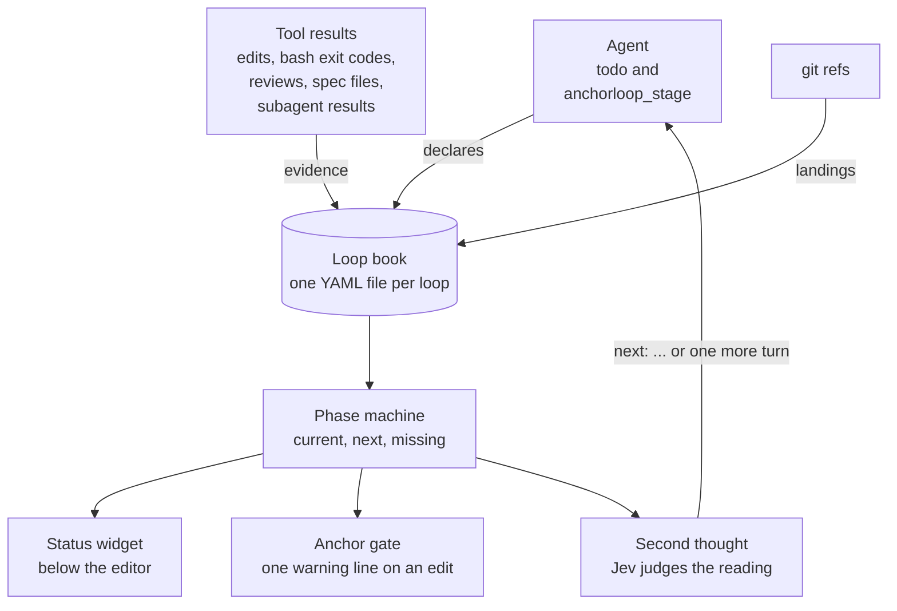
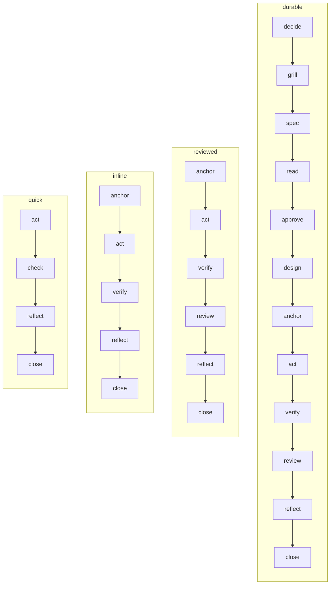
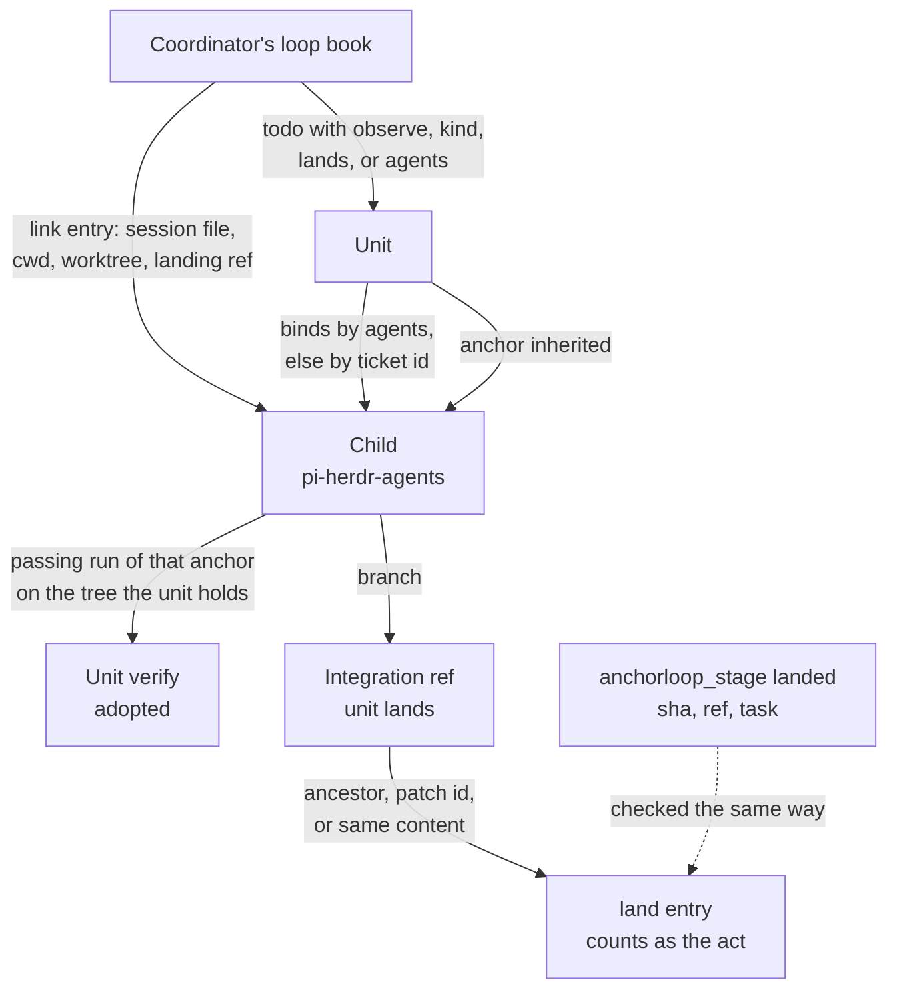
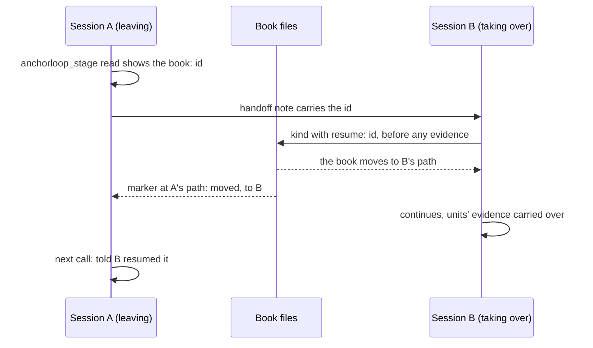

# How anchorloop's extensions work

The full behavior behind the [README](../README.md). The skills tell an agent how to work; the six pi extensions below watch the work and say what is missing, so find the section you need and skip the rest.

anchorloop's extensions keep one loop book per open loop, read what the loop has done from evidence instead of self-report, and turn that into a phase, a status line, a warning, or one more turn.

<!-- Diagram: pi/book.ts (tool_result evidence, setWidget), pi/support/phases.ts (computePhases), pi/anchor-gate.ts (tool_call, tool_result), pi/second-thought.ts (agent_before_settle). -->

| Extension | What it does | Section |
| --- | --- | --- |
| `pi/book.ts` | Keeps the loop book, reads evidence into it, and shows the loop's phase. | [The loop book](#the-loop-book), [Evidence](#evidence), [Phases](#phases), [Reach](#reach), [Anchor runs](#anchor-runs), [Subagents and units](#subagents-and-units), [Landing](#landing), [Handoff](#handoff) |
| `pi/anchor-gate.ts` | Warns when an edit starts the act phase before an earlier phase is complete. | [The anchor gate](#the-anchor-gate) |
| `pi/decision-tool.ts` | The `anchorloop_decision` tool: a decision trail for runs the user reviews later. | [The decision trail](#the-decision-trail) |
| `pi/second-thought.ts` | Asks Jev to check the phase machine's reading when a run settles. | [Second thought](#second-thought) |
| `pi/validate-tool-use.ts` | Validates skills, instruction files, and specs after each edit. | [Validators](#validators) |
| `pi/ttsr.ts` | Time Traveling Stream Rules: a rule fires when the agent's own output matches it. | [Stream rules](#stream-rules) |

## The loop book

A loop's state is a file of entries, and every phase is computed from it.
The agent declares only what the extension cannot observe; everything else is read from evidence.

The first `todo` create opens an `inline` loop, and a `kind` call opens or changes one.

How a loop opens, and what the agent declares

The first `todo` create opens an `inline` loop: its intent is the first todo's subject, and its anchor is a `Reality anchor:` line or the todo's `metadata.anchor`.
A `kind` call also opens or changes a loop.
Task records need the `todo` tool of [`@juicesharp/rpiv-todo`](https://github.com/juicesharp/rpiv-mono/tree/main/packages/rpiv-todo#readme), whose `tool_result` details `{tasks, nextId}` and `rpiv-todo-state` entries the book reads.

The agent declares only what the extension cannot observe, with `anchorloop_stage`:

- `kind`: to choose `quick`, `reviewed`, or `durable`, with an intent and the anchor command; changing a kind the agent chose takes a `reason`.
- `verify`: a check not run in bash.
- `fresh-read`, `friction` (`tried`, `found`, `led_by`), and `reflect`.
- `skip` and `back`.
- `close`, and the query `read`.

The book also records each todo with its `anchor`, `ref` (`<path>#<heading>`, resolved to line ranges), and `followup` metadata.

Where books live, and how they end

One YAML book per open loop lives under `~/.pi/agent/anchorloop/books/`; `ANCHORLOOP_BOOKS_DIR` overrides the directory, and empty project and `agents/` directories are removed.
Subagent books live under `agents/`; a child that closes keeps its book for the main session.
`session_start` sweeps books whose session is gone or that have not changed in 7 days.
Its notice gives one line of counts (open books of this project, stale books deleted), the three newest open books, and the directory holding the rest.

`close` answers `closed (landed). Clear the todo list.`, adding only the phases not shown complete and the unreflected friction.
It never refuses over phases or friction.
It refuses only while a pending or in-progress todo lacks `metadata.followup`: a ticket id, `memory`, or `drop — <reason>`.

## Evidence

An agent's own report that it ran the check proves little, so the book reads what the tools returned.
The extension reads five kinds of evidence and asks the agent only for what none of them can show.

What counts as evidence, and how it is read

- Production edits: a write or edit in any git repo, outside its `scratch/` and `docs/specs/` and the files git ignores. A linked child's edits and a successful `git merge`, `cherry-pick`, or `pull` count too.
- The exit code of the bash call that ran the anchor command. An anchor that passed, failed, and passed again records its own friction entry, already reflected as `resolved`: the rerun command and the failed run's key line, at most 120 characters and never a stack trace. The agent is told nothing.
- Reviewer `Blocking: P0=<n> P1=<m>` counts. They come only from the `reviewer` and `adversarial-reviewer` roles, are read in a subagent session too for its own reviewer, and are counted from the reviewer's dispatch, so a change made while it read is not covered.
- Summaries of `docs/specs/*/` artifacts, read as they are edited.
- A returned subagent that Jev judges to have been a fresh-context read of the spec.

## Phases

Each kind of loop runs a fixed sequence of phases, and the evidence says which are complete.
Nothing blocks: a phase that starts too early earns one warning line, and phases move back by themselves when evidence changes.

<!-- Diagram: SEQUENCES in pi/support/phases.ts. -->

`quick` runs act → check; `inline` runs anchor → act → verify; `reviewed` adds review; `durable` adds decide → grill → spec → read → approve → design before the anchor.
Every kind ends with reflect → close.

The read-out, the widget, and when phases move

`read` shows `<kind> · phase <current> ✓ → <next> (missing: …) · skipped: …`.
The next phase is `fix` when a check or review failed after the last change, else `close`.

A widget below the editor shows `⚓ <kind> · <current> ✓ → <next>`, with `· N friction` while friction waits for a `reflect`.
It updates after every tool call, on `session_start`, and when a `Reality anchor:` line is stated, and it clears when the loop closes.
After a tool call it builds no working tree: it reads only the trees its event already built, and a settle builds each repo's tree once.

A phase that starts before an earlier one is complete warns once, in one line.
Phases regress when evidence changes (a diff after verify, a spec edited back to proposed) or on `back`.

## Reach

A change that reaches further than its kind assumes should be re-classified, so an anchor run measures the diff and asks.
Only `quick` and `inline` loops are measured, since they run no review.

What is counted, the thresholds, and what verify waits for

An anchor run or declared `verify` of a `quick` or `inline` loop measures the diff's reach: source files (not tests, lockfiles, specs, or prose), the top-level directories they sit in, and a README, changelog, or `*.schema.json` changed beside them.
Files already changed when a repo joined the loop count only once their content changes, and a file at a repository root counts as a file, not a directory.

At 3 source files, 2 directories, or one such file, the result carries one line asking to re-classify.
`verify` then waits for a `kind` call with a `reason` that answers each threshold crossed, and a later threshold asks again.

## Anchor runs

A check stands for as long as the code it ran on stays the same, and an anchor is more than one command.
The book therefore records the tree each run saw instead of trusting the clock.

Trees, standing checks, and adopted runs

Every anchor run records the working-state tree of the repo it ran in: a leading `cd` moves it, and an adopted worker run keeps the worker's worktree.
A run stands while that tree is unchanged and no later edit names that repo.
A write in another repo or a worker's edit in its own worktree leaves it standing, and a change through a shell command voids it.

A parent's `git merge`, `cherry-pick`, or `pull` that succeeds, or a returned subagent result, can make a child's run the parent's own verify (`adopted`).
That happens when the parent's working-state trees are exactly the trees of the child's latest run of the same anchor (a leading `cd` into a repo root aside), and that run passed.
A fast-forward of a worker's branch, or a child that worked in the parent's checkout, needs no second run.
A merge onto a base that moved, a parent edit or repo the child never saw, or a file the child ran with but did not commit does.

Run checkpoints and observe checkpoints

An anchor is a run checkpoint plus `observe` checkpoints, which are written on the `kind` call or in todo metadata.
Each `observe` checkpoint is closed by `verify` with its `checkpoint` number, after the last landing.
A prose anchor is not quoted back as a command.

## Subagents and units

A coordinator holds the loop while workers do the work, and the book follows each worker's edits, runs, and landings back to the ticket it serves.
A todo that carries coordination metadata is a unit with phases of its own.

<!-- Diagram: pi/support/units.ts (unitsOf, childAnchor, outDispatches), pi/support/landing.ts (standing, watched), pi/book.ts (adopted verify, landed). -->

Links, the host adapter, and a child's own book

A child is linked only through [pi-herdr-agents](https://github.com/wayne930242/pi-herdr-agents): `PI_SUBAGENT_ID` in the child, `details.id` on the parent's `subagent` result.
pi itself has no subagents.
A linked child's edits are the parent's act.
Its anchor runs, recorded as `check`, carry the working-state tree of each repo it works in: tracked and untracked files, with ignored files and `scratch/` left out.

For a main session that only coordinates, a delegation-host adapter feeds the book.
The adapter is pi-herdr-agents, env-only markers, or none, chosen from the environment.
A link records the child's session file, cwd, worktree, and the integration ref its work lands on.
It adds a base for the child's repo so the diff includes the worker's change.
Spawns made before the first todo are linked when the loop opens.

A child opens its own book from its first edit, commit, or run of its parent's anchor, with no todo.

`read` and `session_start` name each child with no result, with its process, book, and worktree state.

Units: what makes one, how a child binds, and what a unit's checks compare

A todo with `observe`, `kind`, `lands`, or `agents` metadata is a unit.
An `anchor` alone is the task's own check and makes none.
Two or more units get one phase line each in `read`, the widget, and Jev's task list.

A child binds to a unit by `agents`, else by the ticket id in its name or brief when exactly one open todo holds it.

A unit's trees are its workers' worktrees (or checkouts), else the loop's own repos.
An edit counts for the units whose trees hold it, and for every unit when none does.
A unit's checks compare only its trees, so one unit's change leaves another's check standing.

With two or more units:

- `verify` without `task` is refused, with the units listed.
- `back` and `skip` with `task` reach only that unit and take that unit's kind.
- A child inherits its unit's anchor, and its returned passing run of that anchor is recorded as its unit's verify.
- Each `subagent_send` to a persistent reviewer is its own dispatch, and its verdict counts for the unit its brief names.

## Landing

A change has landed when the integration ref holds it, however it got there, so landing is read from git and never from the text of a bash command.

How a landing is decided

A landing is read from git ref state, never from bash text.
When a watched ref moves, a worker's branch counts as landed by ancestry, equal patch ids, or equal content of every path it touched, and `land` counts as the act.
`anchorloop_stage landed` (`sha`, `ref`, `task`) records an owner's notice and checks it the same way.

A loop that lists an observation watches its own repo's integration ref even with no linked child.
A branch this session pushed (git shows the remote-tracking ref moved by its own push) is a car whose landing counts for the unit its name names by ticket.
A push is found through global options with quoted values (`git -c 'credential.helper=!glab auth git-credential' push`, `-C "a b"`, `--git-dir /x`) or a path to `git`, and a branch the command names as a refspec destination (`git push origin agent/mp-x`, `HEAD:refs/heads/x`, `src:dst`) is this session's car even from a checkout on another branch; `--dry-run`, `-n`, `git stash push`, and a branch the command does not name are not.

## Handoff

A new session can take over a loop by the book's id, and what the units proved and what the notice asked carry over.

<!-- Diagram: adoptBook in pi/support/book.ts, the resume handling in pi/book.ts. -->

The id, the refusals, and what the old session sees

A handoff names the open book by the id on the `book:` line of `read`.
The new session adopts it with `resume: <book id>` on its first `kind`, or with the first todo's `metadata.resume`.
What its units proved and what the notice asked carry over; its todos are the new session's, created before or after `resume`, and the old session's todos are retired, so a child reading the adopted book binds by ticket to the new session's unit.

An unknown, closed, subagent's, or other project's id is refused with the reason.
A session on the same ticket that passes no id keeps its own book.
The session that left the book is told which session resumed it on its next tool result, whichever tool it is, and records nothing in the moved book.

## The anchor gate

An edit made before the loop has an anchor is the cheapest moment to say so, so the gate speaks once and lets the edit through.

What it checks, when it speaks, and what it ignores

Inside an open loop, `pi/anchor-gate.ts` appends one warning line to the edit's tool result, where the agent reads it.
It speaks when `write` or `edit` starts the `act` phase while an earlier phase of the loop kind is incomplete.
That is no anchor (`anchor` on the `kind` call, a `Reality anchor:` line, or a skip).
In a `durable` loop it is also a missing decision, spec, fresh read, approval, or design, read from the `docs/specs/<folder>/` files, found from the book, the intent, or a todo `ref`.

It warns again only when a new phase goes missing, and the call still goes through.
Outside a loop and in `quick` loops it stays silent.
`.md`, `.txt`, and `.html` files, `scratch/`, `docs/specs/`, and temp files outside the project pass silently.
Edits made through `bash` are not checked.

## The decision trail

A run the user reviews after stepping away needs its forks written down as they happen, one row each.

What a row is

The `anchorloop_decision` tool of `pi/decision-tool.ts` appends single-line, spreadsheet-safe rows to a decision trail TSV for forks, pivots, and blockers.
Completed units come from `git log`.
A `start` row marks a run that picks up another run's trail.

## Second thought

The program computes the next phase from the book's evidence, and Jev, TypeSafe's typed-decision model, only judges whether that reading is right.
Its advice is short and arrives only when it changes what the agent does next.

What it runs on, and what Jev sees and judges

Inside an open loop, `pi/second-thought.ts` asks Jev through pi's classifier registry to check the phase machine.
It asks when a run settles and the loop book gained an evidence entry since the last judgment, and at a `close` declaration.
Without a TypeSafe key it does nothing, and outside a loop it never runs.
In a subagent session (`PI_SUBAGENT_ID` from pi-herdr-agents, or `PI_SUBAGENT_CHILD` from pi-subagents) it registers nothing, since the agent that spawned it judges the result.

Jev sees the kind, intent, anchor, diff summary (≤1200 chars), `phase` (current, next, missing), verify state, the open todos by id and subject, the task list, and friction (a child's under its name).
It judges only whether to `advance`, go `back`, or `ask-user`, plus `done`, the review tier still needed, and quality.
Phase completion comes from the program's evidence alone.

A new judgment is triggered only by evidence entries or by a new open todo without a followup.
A child's result counts as evidence; task, link, base, and watch records do not.

The advisory: when it speaks, when it continues the run, and when it repeats nothing

The advisory is `next: <phase> (<missing>)` plus Jev's concerns, with no scores.
It is sent only when Jev has a concern, todos are open without a followup, or the run continues.
It stays silent when Jev agrees with nothing to add, and the verdict is still recorded in the session.
At close it carries concerns only.

Away from close it also names the loop's open todos that have no valid `metadata.followup`: the first three, subjects cut to 60 characters, then `+N more`.
It asks the agent to continue each, complete it, or set that followup.

The run continues once, when Jev agrees to advance and the next phase is a verify, review, or fix, or when such todos are open and Jev's move is not `ask-user`.
In that last case the advisory tells the agent to ask the user instead.

An advisory with the same Jev move, next phase, assessment findings, and open todo ids as the last one is not repeated.
Jev's move is part of that key, so a turn to `back` or `ask-user` on new evidence is advised even when the rest repeats.
A `full` rating after a clean review that follows the last change is not a concern.

When it stays quiet: waiting runs, children, and units

A run that called `MonitorCreate`, `LoopCreate`, or `goal_wait`, or a `subagent` tool whose child the book has not linked yet, is waiting and is not judged.
While a child the loop started has no result and its host does not report it gone, the loop is neither judged nor continued.
A child that finished exits before its result is delivered, so a gone child whose session file was written within the last 30 seconds still counts as out. A dispatch with `accept` waits while the host reruns its check, so its grace grows by the check's `timeoutSec` (600 seconds by default).

With two or more units the quiet is per unit.
The notice judges, speaks, and continues for the first unit that waits on the coordinator: started, not done, nothing of its own out, and its step not asked since that unit's last evidence.
It names every other such unit on its own `next:` line, and asks a unit again only when its step or evidence changes.

What the notice judged and said is kept in the book (`notice` entries), so a `/reload` or a session that adopts the book does not repeat it.

## Validators

Skill and instruction files drift in small ways that are cheap to catch the moment they are written.

What is validated, and where the rules live

After each `write` or `edit`, `pi/validate-tool-use.ts` validates the file in-process (`pi/support/validators.ts`, a port of `hooks/validators/`).
It appends suggestions for `SKILL.md` (at most three red-line advisories per edit), instruction files (`AGENTS.md`, `CLAUDE.md`, `GEMINI.md`, `rules/`), and `docs/specs/` artifacts.
It needs no Python.
The Python validators in `hooks/` remain for `validate_all.py` and the parity test.

## Stream rules

A rule that must hold in the agent's own output is cheapest when it fires at the moment the output breaks it, so a match rewinds the response and retries with the rule in hand.
`pi/ttsr.ts` is a port of oh-my-pi's Time Traveling Stream Rules.

Rule files, matching, and frontmatter

A Markdown rule in `~/.pi/agent/rules/` or `<project>/.pi/rules/` whose frontmatter has a `condition` regex is watched during the run.
A match in streamed assistant text aborts the response, drops it, and retries with the rule injected.
A match in tool arguments (the command for `bash`, the new text for `write` and `edit`) blocks the call with the rule as its reason.

Frontmatter fields follow oh-my-pi: `condition`, `scope` (`text`, `thinking`, `tool`, `tool:bash`, `tool:edit(*.ts)`), `globs`, and `interruptMode` (`always`, `prose-only`, `tool-only`, `never`).
`repeatMode` (`once` or `after-gap`) and `repeatGap` are added.
Each injected rule arrives as `<rule name="…">body</rule>`.
A rule fires once per session by default.

`astCondition`, `question`, and `agents` are not supported; a rule that uses them is skipped and reported.
`/ttsr` lists the loaded rules.

