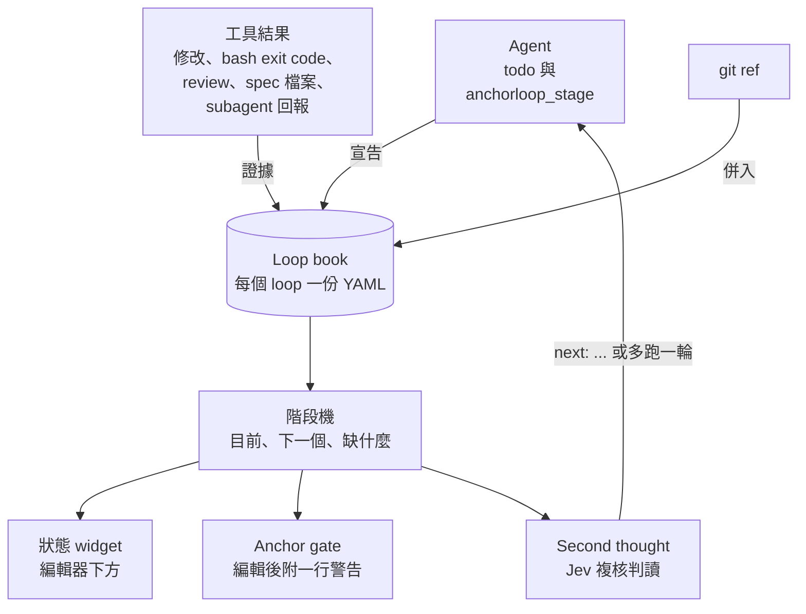
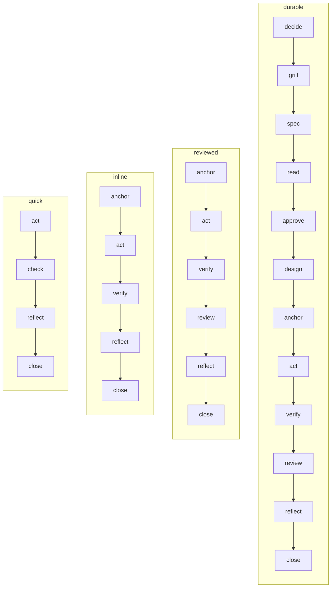
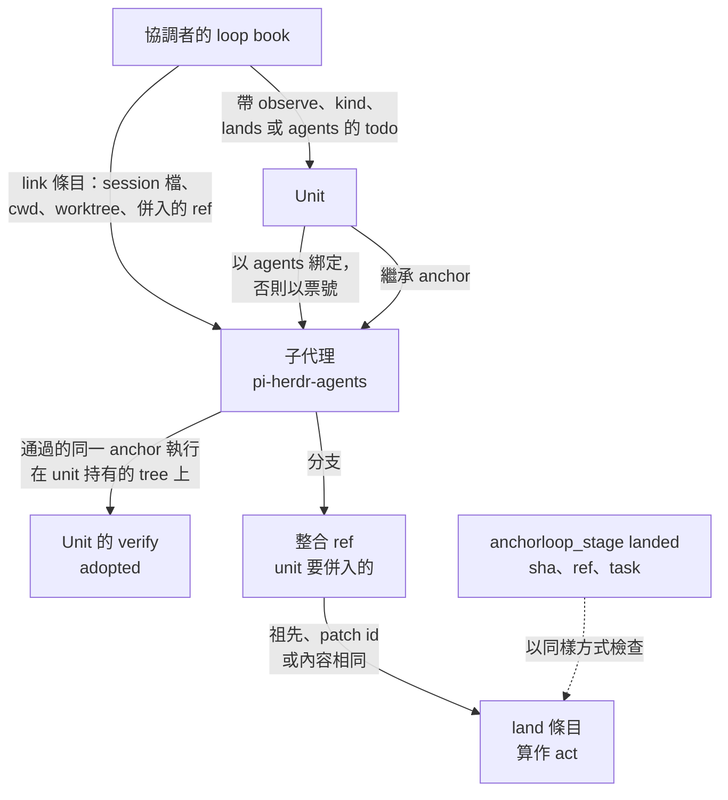
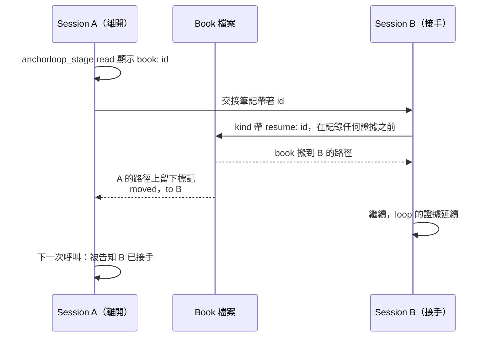

# anchorloop 擴充功能的運作方式 <!-- source: docs/how-it-works.md @ a522c27 -->

[README](../README.zh-TW.md) 背後的完整行為。skill 告訴 agent 怎麼工作；下面六個 pi extension 則盯著工作進行，說出還缺什麼，所以請找到需要的那一節，其餘可以略過。

anchorloop 的 extension 替每個開啟中的 loop 維護一份 loop book，從證據而不是自我回報讀出 loop 做了什麼，再把它變成階段、狀態列、警告，或多跑一輪。

<!-- 圖：pi/book.ts（tool_result 證據、setWidget）、pi/support/phases.ts（computePhases）、pi/anchor-gate.ts（tool_call、tool_result）、pi/second-thought.ts（agent_before_settle）。 -->

| Extension | 作用 | 章節 |
| --- | --- | --- |
| `pi/book.ts` | 維護 loop book，把證據讀進去，並顯示 loop 的階段。 | [Loop book](#the-loop-book)、[證據](#evidence)、[階段](#phases)、[影響範圍](#reach)、[Anchor 執行](#anchor-runs)、[子代理與 unit](#subagents-and-units)、[併入](#landing)、[交接](#handoff) |
| `pi/anchor-gate.ts` | 前面的階段還沒完成就用編輯開始 act 階段時，發出警告。 | [Anchor gate](#the-anchor-gate) |
| `pi/decision-tool.ts` | `anchorloop_decision` 工具：給使用者事後複查的執行記決策軌跡。 | [決策軌跡](#the-decision-trail) |
| `pi/second-thought.ts` | 一次執行結束時，請 Jev 複核階段機的判讀。 | [Second thought](#second-thought) |
| `pi/validate-tool-use.ts` | 每次編輯後驗證 skill、指令檔與 spec。 | [驗證器](#validators) |
| `pi/ttsr.ts` | Time Traveling Stream Rules：agent 自己的輸出命中規則時，規則就觸發。 | [串流規則](#stream-rules) |

## Loop book

一個 loop 的狀態是一份條目檔，每個階段都從它算出來。
agent 只宣告 extension 看不到的事；其餘都從證據讀出。

第一次 `todo` create 會以 `inline` 開啟 loop，`kind` 呼叫也能開啟或更改 loop。

loop 怎麼開啟，以及 agent 宣告什麼

第一次 `todo` create 會以 `inline` 開啟 loop：intent 取第一個 todo 的標題，anchor 取 `Reality anchor:` 這一行或該 todo 的 `metadata.anchor`。
`kind` 呼叫也能開啟或更改 loop。
任務紀錄需要 [`@juicesharp/rpiv-todo`](https://github.com/juicesharp/rpiv-mono/tree/main/packages/rpiv-todo#readme) 的 `todo` 工具，book 讀它的 `tool_result` details `{tasks, nextId}` 和 `rpiv-todo-state` 條目。

agent 只用 `anchorloop_stage` 宣告 extension 看不到的事：

- `kind`：用來選 `quick`、`reviewed` 或 `durable`，附 intent 和 anchor 指令；改掉 agent 自己選的種類時，必須附 `reason`。
- `verify`：不是 bash 指令的檢查。
- `fresh-read`、`friction`（`tried`、`found`、`led_by`）與 `reflect`。
- `skip` 與 `back`。
- `close`，以及查詢用的 `read`。

book 也記錄每個 todo 的 `anchor`、`ref`（`<path>#<heading>`，解析成行號範圍）和 `followup` metadata。

book 放在哪裡，怎麼結束

每個開啟中的 loop 有一份 YAML book，放在 `~/.pi/agent/anchorloop/books/`；可用 `ANCHORLOOP_BOOKS_DIR` 覆寫目錄，空的專案目錄與 `agents/` 目錄會被移除。
subagent 的 book 放在 `agents/`；subagent 自己 close 時，book 留給主 session。
`session_start` 會清掉 session 已不存在或 7 天沒有更新的 book。
提示只用一行列出數量（本專案未關的 book、刪掉的過期 book），再列最新三本與其餘所在的目錄。

每天一次（books 目錄旁的 `books-sweep.stamp` 記著上次執行的時間），`session_start` 也會清專案目錄：worktree 被移除後，只要還活著的主 session 連著裡面的子 book，它的專案目錄就會留下來。
專案目錄只在下列條件全部成立時才移除：它的 book 記下的每個 `cwd` 路徑都已不存在、裡面沒有任何開啟中的 loop（沒有 close 的 book）或尚未回報的派工、裡面 7 天沒有任何寫入（book 算過期的年齡）、books 目錄下沒有任何未結案的 book 連著裡面某個子代理的 book，而且它不是這個 session 自己的專案。
每次移除都會在目錄被刪掉之前，記進 books 目錄旁的 `books-sweep.log`，提示也會加上移除的數量。
已結案的子 book 只要有未結案的主 session book 連著就會留下；那本主 book 結案後，它的目錄可在之後某天被移除。
連結每次清理只建一次索引。

`close` 回覆 `closed (landed). Clear the todo list.`，只多列沒有完成的階段和還沒 reflect 的 friction。
它不會因為階段或 friction 而拒絕。
只在還有 pending 或 in-progress 的 todo 沒有 `metadata.followup` 時拒絕：票號、`memory` 或 `drop — <reason>`。

## 證據

agent 自己說跑過檢查，證明力很低，所以 book 讀的是工具回傳了什麼。
extension 讀五種證據，只向 agent 要這些都看不到的事。

什麼算證據，以及怎麼讀

- production 的修改：任何 git repo 內、`scratch/`、`docs/specs/` 與 git 忽略的檔案以外的 write 或 edit。已連結 child 的修改，以及成功的 `git merge`、`cherry-pick`、`pull` 也算。
- 執行過 anchor 指令的那次 bash 的 exit code。anchor 通過後失敗、又再通過時，extension 會自己記一筆 friction，並直接 reflect 為 `resolved`：重跑的指令，加上失敗那次最關鍵的一行輸出，最多 120 字元，不放 stack trace。不會通知 agent。
- reviewer 的 `Blocking: P0=<n> P1=<m>` 數字。只採 `reviewer` 與 `adversarial-reviewer` 角色；subagent session 也讀自己派的 reviewer；從 reviewer 被派出的時間起算，所以它閱讀期間的改動不算被審過。
- `docs/specs/*/` 產出物每次編輯後的摘要。
- Jev 判定為「全新 context 讀過 spec」的 subagent 回報。

## 階段

每種 loop 有固定的階段順序，證據說明哪些階段已完成。
沒有任何東西會擋下：太早開始的階段只會得到一行警告，證據改變時階段會自己退回。

<!-- 圖：pi/support/phases.ts 的 SEQUENCES。 -->

`quick` 為 act → check；`inline` 為 anchor → act → verify；`reviewed` 加 review；`durable` 在 anchor 之前再加 decide → grill → spec → read → approve → design。
每一種都以 reflect → close 結尾。

read 的輸出、widget，以及階段何時移動

`read` 顯示 `<kind> · phase <current> ✓ → <next> (missing: …) · skipped: …`。
最後一次修改之後有 check 或 review 失敗時，下一個階段是 `fix`，否則是 `close`。

編輯器下方的 widget 會顯示 `⚓ <kind> · <current> ✓ → <next>`，還有 friction 等著 `reflect` 時附 `· N friction`。
它在每次工具呼叫後、`session_start` 時，以及 agent 寫出 `Reality anchor:` 這一行時更新，loop 結案後清掉。
工具呼叫之後它不建工作樹：只讀該事件已建好的 tree，settle 對每個 repo 只建一次。

前一個階段還沒完成就開始下一個階段，會用一行警告一次。
證據改變（verify 之後又有 diff、spec 被改回 proposed）或用 `back` 時，階段會退回。

## 影響範圍

一項改動影響的範圍比它的種類假設的更大時，應該重新分類，所以 anchor 執行會量 diff 並提問。
只量 `quick` 與 `inline` loop，因為它們不跑 review。

算什麼、門檻，以及 verify 在等什麼

`quick` 或 `inline` loop 跑 anchor 或宣告 `verify` 時，會量 diff 的影響範圍：原始碼檔案（不含測試、lockfile、spec 與文字檔）、它們所在的頂層目錄，以及跟原始碼一起改的 README、changelog 或 `*.schema.json`。
repo 加入 loop 時就已經改過的檔案，要等內容再變動才算；repo 根目錄的檔案只算檔案數，不算一個目錄。

達到 3 個原始碼檔案、2 個目錄或 1 個這類檔案時，結果會附一行請 agent 重新分類。
`verify` 要等到以 `reason` 呼叫 `kind`、回應每一個跨過的門檻才算完成，之後再跨過新的門檻會再問一次。

## Anchor 執行

檢查只在它跑過的程式碼沒變時才成立，而且 anchor 不只一道指令。
所以 book 記錄每次執行看到的 tree，而不是相信時鐘。

tree、仍成立的檢查，以及採用的執行

每次 anchor 執行都記下它執行所在 repo 的工作狀態 tree：開頭的 `cd` 會改變所在位置，採用的 worker 執行保留 worker 的 worktree。
只要那個 tree 沒變、之後也沒有指向那個 repo 的修改，這次檢查就仍成立。
在別的 repo 寫檔、或 worker 在自己的 worktree 裡修改，不影響它；透過 shell 指令改了程式碼，它就失效。

父 session 的 `git merge`、`cherry-pick`、`pull` 成功時，或收到子代理結果時，子代理的執行可以成為父 loop 自己的 verify（`adopted`）。
條件是父 session 的工作狀態 tree 正好等於子代理最近一次同一 anchor 執行的 tree（忽略開頭切到 repo 根目錄的 `cd`），且那次通過。
fast-forward 合入 worker 分支、或子代理直接在父 checkout 裡工作，都不必再跑一次。
合到已前進的 base、父 session 有子代理沒看過的改動或 repo、或子代理跑測試時有沒 commit 的檔案，則要自己跑。

執行檢查點與 observe 檢查點

anchor 是一個執行檢查點，加上 `observe` 檢查點，寫在 `kind` 或 todo metadata。
每一項 `observe` 檢查點都要在最後一次併入之後，以 `verify` 加 `checkpoint` 編號結案。
純文字的 anchor 不會被當成指令引用。

## 子代理與 unit

協調者握著 loop，worker 做事，book 把每個 worker 的修改、執行與併入追回它服務的那張票。
帶有協調 metadata 的 todo 是一個 unit，有自己的階段。

<!-- 圖：pi/support/units.ts（unitsOf、childAnchor、outDispatches）、pi/support/landing.ts（standing、watched）、pi/book.ts（adopted verify、landed）。 -->

link、host adapter 與子代理自己的 book

子代理只透過 [pi-herdr-agents](https://github.com/wayne930242/pi-herdr-agents) 關聯：子行程的 `PI_SUBAGENT_ID`、父 session `subagent` 結果的 `details.id`。
pi 本身沒有 subagent。
關聯的子代理，其改動算父 loop 的 act。
其 anchor 執行記為 `check`，並附上它所在各 repo 的工作狀態 tree：含已追蹤與未追蹤檔案，不含 ignored 檔案與 `scratch/`。

對只負責協調的主 session，book 會透過 delegation host adapter 取得更多資訊。
adapter 是 pi-herdr-agents、只有環境變數標記的 host，或沒有 host，由環境自動判斷。
link 會記下子代理的 session 檔、cwd、worktree 與它的成果要併入的整合 ref。
它為子代理的 repo 加一個 base，讓 diff 包含 worker 的改動。
第一個 todo 之前派出的子代理，在 loop 開啟時補上 link。

子代理第一次編輯、commit 或執行父 loop 的 anchor 時，不需要 todo 就會開啟自己的 book。

`read` 與 `session_start` 會列出沒有回報結果的子代理，附上行程、book 與 worktree 狀態。

unit：什麼構成 unit、子代理怎麼綁定，以及 unit 的檢查比對什麼

帶有 `observe`、`kind`、`lands` 或 `agents` metadata 的 todo 是一個 unit。
只有 `anchor` 時是該任務自己的檢查，不構成 unit。
兩個以上 unit 時，`read`、widget 與 Jev 的任務清單各給每個 unit 一行階段。

子代理以 `agents` 綁定 unit，沒有的話，在恰有一個未完成 todo 含有它的名稱或 brief 裡的票號時綁定。

unit 的 tree 是它 worker 的 worktree（或 checkout），沒有的話是 loop 自己的 repo。
修改算給 tree 含有它的 unit，都不含時算給每個 unit。
unit 的檢查只比對自己的 tree，所以一個 unit 的修改不會讓另一個 unit 的檢查失效。

有兩個以上 unit 時：

- 沒有 `task` 的 `verify` 會被拒絕，並列出各 unit。
- 帶 `task` 的 `back` 與 `skip` 只影響那個 unit，並依那個 unit 的種類檢查。
- 子代理繼承所屬 unit 的 anchor，它回報時通過的那個 anchor 執行會記為該 unit 的 verify。
- 每次對常駐 reviewer 的 `subagent_send` 都是一次獨立派工，結論算給 brief 指名的 unit。

## 併入

整合 ref 握有那項改動，它就算併入了，不管是怎麼到那裡的，所以併入從 git 讀出，從不解析 bash 指令的文字。

併入怎麼判定

併入由 git ref 狀態判斷，不解析 bash 文字。
被監看的 ref 前進時，worker 的分支只要是祖先、patch id 相同，或所改每個路徑的內容相同，就算已併入，`land` 算 act。
`anchorloop_stage landed`（`sha`、`ref`、`task`）記錄擁有者的通知，並以同樣規則檢查。

列了 observation 的 loop，即使沒有關聯子代理，也監看自己 repo 的整合 ref。
這個 session 自己 push 的分支（git 顯示 remote-tracking ref 是被它自己的 push 移動的）是一節車廂，併入後算給分支名稱裡票號所指的 unit。
為較早的 todo 清單（`todo clear` 或 `resume` 之前）的 todo 所 push 的車廂，併入後不算給任何 unit；為同一票號重建的 unit 要以 `anchorloop_stage landed` 帶上自己的 `task` 才能認領，其他票號的 unit 認領不了，而不帶 `task` 的 `landed` 只會回 `already recorded`。
偵測 push 時，`git` 與 `push` 之間可以有帶引號值的全域選項（`git -c 'credential.helper=!glab auth git-credential' push`、`-C "a b"`、`--git-dir /x`），`git` 也可以是帶路徑的形式；指令中以 refspec 目的地點名的分支（`git push origin agent/mp-x`、`HEAD:refs/heads/x`、`src:dst`），即使 checkout 在另一個分支上，也是這個 session 的車廂；`--dry-run`、`-n`、`git stash push`，以及指令沒有點名的分支則不是。

## 交接

新 session 可以用 book 的 id 接手 loop，loop 已證明的事與提醒問過的事都會延續。

<!-- 圖：pi/support/book.ts 的 adoptBook，以及 pi/book.ts 處理 resume 的部分。 -->

id、拒絕的情形，以及舊 session 看到什麼

交接時以 `read` 的 `book:` 行寫明未關 book 的 id。
新 session 在第一次 `kind` 帶 `resume: <book id>`，或在第一個 todo 的 `metadata.resume` 接手那本 book。
loop 已證明的事與提醒問過的事都會延續；book 的 todo 從此是新 session 的，不論建在 `resume` 之前或之後，舊 session 的 todo 則連同為它們記錄的執行、verify、落地與審查一起退場，所以沿用舊 id 的新 todo 要自己掙得證據，與 `todo clear` 之後相同。讀取接手後 book 的子代理會依票號綁到新 session 的 unit，而舊 session 派出、沒有新 unit 綁到的子代理，保留它派工時那個 unit 的 anchor。

不存在、已關、屬於 subagent 或其他專案的 id 會被拒絕並說明原因。
同一張票上沒帶 id 的另一個 session 保有自己的 book。
交出 book 的 session 在下一次工具結果（不論哪個工具）時會被告知是哪個 session 接手，也不再於已搬走的 book 記錄任何東西。

## Anchor gate

在 loop 還沒有 anchor 時就動手編輯，是最便宜的提醒時機，所以 gate 只說一次，編輯照樣放行。

它檢查什麼、何時開口、忽略什麼

只在開啟的 loop 內，`pi/anchor-gate.ts` 把一行警告附在該次編輯的 tool result 後面，agent 在那裡讀到它。
`write` 或 `edit` 開始 `act` 階段、而這種 loop 前面的階段還沒完成時才發出。
這包括沒有 anchor（`kind` 呼叫的 `anchor`、`Reality anchor:` 這一行，或已跳過）。
`durable` loop 則還包括缺決策、spec、全新 context 的閱讀、核准或設計，從 `docs/specs/<folder>/` 的檔案判斷，資料夾由 book、intent 或 todo 的 `ref` 找出。

只有新缺了一個階段時才會再警告，呼叫仍會放行。
沒有 loop 或是 `quick` loop 時保持安靜。
`.md`、`.txt`、`.html` 檔、`scratch/`、`docs/specs/` 和專案外的暫存檔不會觸發。
透過 `bash` 做的修改不檢查。

## 決策軌跡

使用者事後複查的執行，要在岔路出現的當下把它寫下來，一筆一行。

一筆記錄是什麼

`pi/decision-tool.ts` 的 `anchorloop_decision` 工具把一筆決策寫進 TSV 決策軌跡，記岔路、轉向與卡點，每筆只佔一行，用試算表開啟也安全。
完成的工作單元看 `git log`。
接手別人的軌跡時寫一筆 `start`。

## Second thought

下一個階段由程式從 book 的證據算出，Jev（TypeSafe 的型別化決策模型）只判斷這個判讀對不對。
它的提醒很短，而且只在會改變 agent 下一步時才出現。

它在什麼時候執行，以及 Jev 看到並判斷什麼

只在開啟的 loop 內，`pi/second-thought.ts` 透過 pi 的 classifier registry 請 Jev 複核階段機。
一次執行結束且 book 自上次判斷後多了證據條目時，以及宣告 `close` 時，才會問。
沒有 TypeSafe key 時什麼都不做，沒有 loop 時不會執行。
subagent session（pi-herdr-agents 的 `PI_SUBAGENT_ID`，或 pi-subagents 的 `PI_SUBAGENT_CHILD`）不註冊任何東西，因為由派它的 agent 判斷結果。

Jev 看到種類、intent、anchor、diff 摘要（≤1200 字元）、`phase`（目前、下一個、缺什麼）、verify 狀態、未完成 todo（id 與標題）、任務清單和 friction（子 agent 的以它的名字列出）。
它只判斷要 `advance`、退回（`back`）還是 `ask-user`，另外還問 `done`、還需要哪一級 review 與品質。
階段是否完成只由程式依證據判定。

只有證據類條目或新出現的、沒有 followup 的未完成 todo 會觸發新的判斷。
子代理的回報算證據；task、link、base、watch 紀錄不算。

提醒：何時開口、何時讓 loop 多跑一輪、何時不重複

提醒是 `next: <phase> (<missing>)` 加上 Jev 的疑慮，不附分數。
只在 Jev 有疑慮、有 todo 未完成而沒有 followup、或這次會讓 agent 多跑一輪時才送出。
Jev 同意且沒有補充時保持安靜，判斷結果仍記在 session 裡。
結案時只附疑慮。

離開 close 時，提醒也會點名 loop 中還沒有有效 `metadata.followup` 的未完成 todo：前三個，標題截成 60 字元，其餘以 `+N more` 帶過。
請 agent 逐一繼續、完成，或設定該 followup。

Jev 同意前進、而下一個階段是 verify、review 或 fix，或有這類 todo 未完成且 Jev 的判斷不是 `ask-user` 時，才讓 agent 多跑一輪。
在最後這種情況，提醒改請 agent 去問使用者。

Jev 的判斷、下一個階段、評估發現和未完成 todo 的 id 都與上一則相同的提醒不重複。
Jev 的判斷也在比對鍵裡，所以在新證據上轉成 `back` 或 `ask-user` 時，即使其餘相同也會送出提醒。
最後一次修改之後已有無 blocking 發現的 review 時，`full` 評等不算疑慮。

何時保持安靜：等待中的執行、子代理與 unit

呼叫過 `MonitorCreate`、`LoopCreate`、`goal_wait`，或呼叫了 `subagent` 類工具而 book 還沒關聯到子代理的執行在等待中，不被判斷。
loop 派出的子代理還沒回報、且它的 host 沒有回報它已消失時，loop 既不被判斷也不會多跑一輪。
子代理完成時會先結束行程、結果才送達，所以已消失但 session 檔在最近 30 秒內寫過的子代理仍算在外。帶 `accept` 的派工要等子代理自己跑完檢查、host 再重跑一次，寬限再加上兩倍的檢查 `timeoutSec`（預設 600 秒）。

有兩個以上 unit 時，改為逐 unit 安靜。
提醒為第一個等著協調者的 unit 判斷、發言並決定是否多跑一輪：已開始、未完成、自己沒有派出在外的子代理，而且自該 unit 最後一筆證據以來還沒問過它這一步。
其他同樣等著的 unit 各列一行 `next:`；只有 unit 的步驟或證據改變時才會再問。

提醒判斷過與說過的內容記在 book 裡（`notice` 條目），所以 `/reload` 或接手這本 book 的 session 都不會重複。

## 驗證器

skill 與指令檔常有小地方偏掉，寫下的當下最容易便宜地抓到。

驗證什麼，規則放在哪裡

每次 `write` 或 `edit` 後，`pi/validate-tool-use.ts` 在行程內驗證該檔（`pi/support/validators.ts`，移植自 `hooks/validators/`）。
它替 `SKILL.md`（每次編輯最多三則紅線提醒）、指令檔（`AGENTS.md`、`CLAUDE.md`、`GEMINI.md`、`rules/`）和 `docs/specs/` 產出物附上建議。
不需要 Python。
`hooks/` 的 Python 驗證器仍供 `validate_all.py` 和對照測試使用。

## 串流規則

必須在 agent 自己的輸出裡成立的規則，最便宜的做法是在輸出違反它的當下觸發，所以命中時就倒回回應，帶著規則重試。
`pi/ttsr.ts` 移植自 oh-my-pi 的 Time Traveling Stream Rules。

規則檔、比對與 frontmatter

`~/.pi/agent/rules/` 或 `<project>/.pi/rules/` 裡 frontmatter 帶有 `condition` regex 的 Markdown 規則，會在執行過程中被監看。
assistant 串流文字命中時，中斷回應、丟棄那段輸出，並注入規則後重試。
工具參數命中時（`bash` 看指令，`write`／`edit` 看新寫入的文字），直接擋下呼叫，以規則內容作為理由。

frontmatter 欄位沿用 oh-my-pi：`condition`、`scope`（`text`、`thinking`、`tool`、`tool:bash`、`tool:edit(*.ts)`）、`globs`、`interruptMode`（`always`、`prose-only`、`tool-only`、`never`）。
另加 `repeatMode`（`once` 或 `after-gap`）與 `repeatGap`。
注入的規則以 `<rule name="…">body</rule>` 送出。
預設每條規則每個 session 只觸發一次。

不支援 `astCondition`、`question`、`agents`，用到的規則會被跳過並回報。
`/ttsr` 列出已載入的規則。

