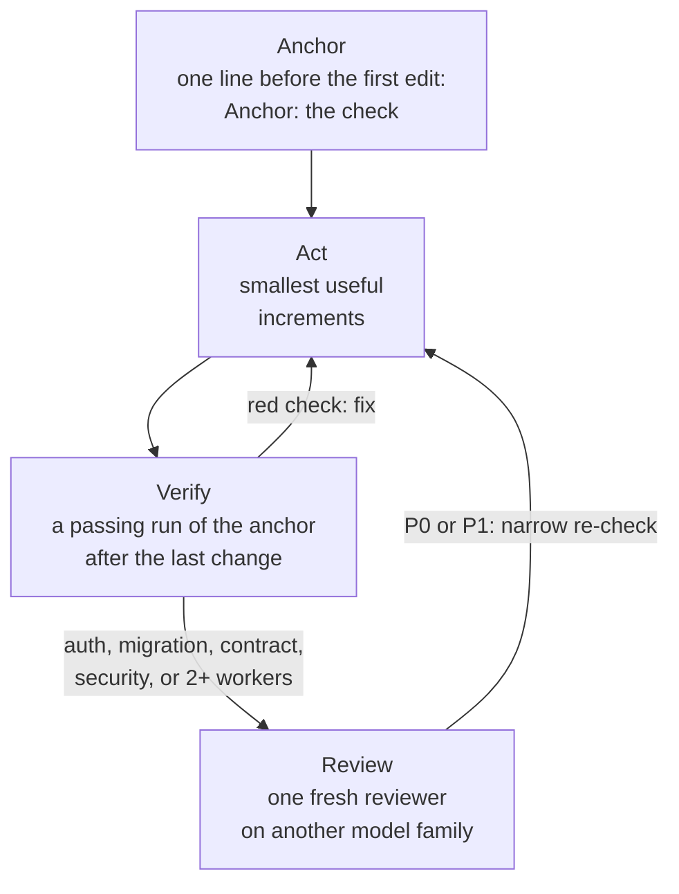

anchorloop has two halves.
The skills tell an agent how to work: one entry skill per kind of task, each with playbooks, all running the same loop.
Two small extensions catch what is cheap to catch in code: a close without a passing anchor run, and a skill file that drifts.

## The loop

Every task runs one rule: state the check, change, show it passing.

<!-- Diagram: "The rule" in skills/anchorloop/SKILL.md and pi/close-guard.ts. -->

What each step asks for

- **Anchor.** Before the first edit the agent writes `Anchor: <check>`, with each command in backticks, or the review or person's verdict that observes the result. A todo's `metadata.anchor` also counts.
- **Act.** Small increments through the project's native practices, deleting before adding. Delegate units of work; the session that holds the request keeps the anchor and the reply.
- **Verify.** After the last change, show a passing run of the anchor and report what it observed. A requirement the anchor did not exercise is `unknown`, whatever other checks show.

## Anchors

An anchor is the exact check that observes the result, and it is chosen before the first change.
A check seen only green proves nothing, so a check written for this run is first run red for the stated reason.
Runs are not repeated without cause: before a run, the agent collects the green runs on record for the tree and runs only what covers the diff since the last green one.

Gate changes are not fixes

Raising a budget, adding an allowlist or ignore entry, skipping or xfailing a test, and disabling or soft-failing a check are gate changes.
The reply names each with its reason for the user to accept, and puts them before the reviewer too, because the author is the one who wants green.

## Review

A change that touches authorization or permission data, a migration, a shared contract, or security, and any work that two or more workers carried, gets one fresh-context reviewer.
The reviewer runs on a model family different from the author's, because the same model tends to miss the same things it wrote.
P0 and P1 findings block the merge and get a narrow re-check of those findings and the lines their fixes changed; P2 and lower become follow-ups.

## The close guard

When a run settles after a file change with no passing run of the backticked anchor since, the close guard adds one line to the session, such as ``anchorloop: no passing run of `pytest -q` after the last change.``
The line never starts a turn; the agent answers it with the run, or with why the anchor does not apply.
[The close guard](/anchorloop/reference/how-it-works/the-close-guard/) lists exactly what counts.

## Friction becomes a rule

When an instruction misled an attempt, the agent notes what it said and what the attempt found, and `solid-loop` fixes the instruction at its root after the task.

The two classes

- **Misdirection**: the instruction states or implies something the attempt found false. The `apply-friction` playbook corrects or deletes that line.
- **Gap**: no instruction in use states the fact found. The playbook places it where it belongs, preferring a mechanism (an architecture, script, lint, or test) over prose.

