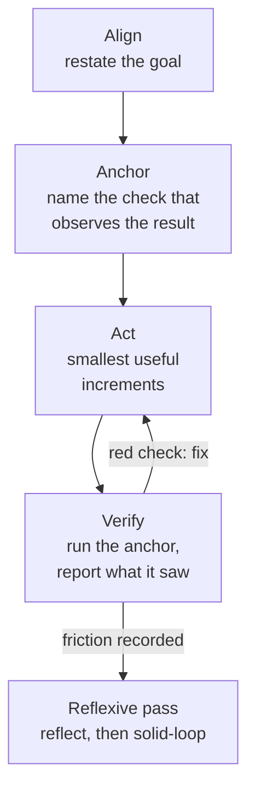
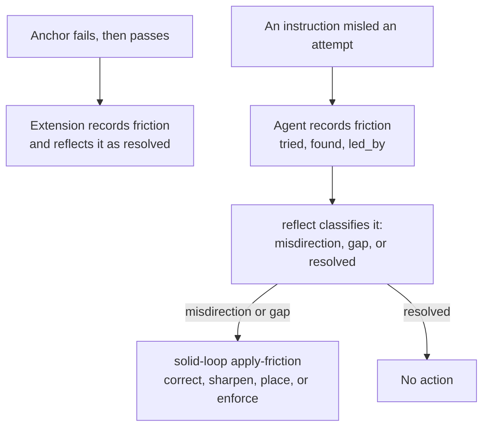

anchorloop has two halves.
The skills tell an agent how to work: one entry skill per kind of task, each with playbooks, all running the same loop.
The extensions watch the work and say what is missing.

## The loop

Every task runs Align → Anchor → Act → Verify, and a Reflexive pass follows when the run recorded friction.

<!-- Diagram: the four loop sections and the Reflexive Pass of skills/anchorloop/SKILL.md. -->

What each step asks for

- **Align.** The first reply on any task but a fully specified one-line edit opens with `Alignment: <goal, problem, smallest change>`, in the user's language, and proceeds without waiting.
- **Anchor.** Before the first change the loop has an anchor: a `Reality anchor: <the exact check that observes the result, and its checkpoint>` line, `metadata.anchor` on the first todo, or `anchor` on a `kind` call.
- **Act.** Small increments through the project's native practices, deleting before adding. Delegate units of work; the session that holds the request keeps the loop.
- **Verify.** Run the anchor and report what it observed. A requirement the anchor did not exercise is `unknown`, whatever other checks show.

## Kinds

A loop has one of four kinds, and the kind fixes its sequence of phases.
The first `todo` opens an `inline` loop; a `kind` call chooses another.

| Kind | For | Phases |
| --- | --- | --- |
| `quick` | A config value, a typo, a small tweak. | act → check → reflect → close |
| `inline` | The default: the change stays inside the files it edits. | anchor → act → verify → reflect → close |
| `reviewed` | The change reaches past its files: a shared contract, permissions, a migration, or security. | anchor → act → verify → review → reflect → close |
| `durable` | The work needs a persistent design record: ambiguity, a trade-off the user owns, or a spec the user asked for. | decide → grill → spec → read → approve → design → anchor → act → verify → review → reflect → close |

When to change the kind

An anchor run on a `quick` or `inline` loop measures the diff.
At three source files, two top-level directories, or one README, changelog, or schema file changed beside source code, the result asks to re-classify, and `verify` waits for a `kind` call whose `reason` answers it.
A `durable` loop keeps its record in `docs/specs/<date>-<slug>/`: `decision.md`, `spec.md`, `design.md`, and `verification.md`, each created when its phase is reached.

[Phases](/anchorloop/reference/how-it-works/phases/) draws each sequence, and [Reach](/anchorloop/reference/how-it-works/reach/) lists the thresholds.

## Anchors and checkpoints

An anchor is the exact check that observes the result, and it is chosen before the first change.
A check seen only green proves nothing, so a check written for this run is first run red for the stated reason.

An anchor has a run checkpoint, the command run before landing, and `observe` checkpoints for what only the landed result shows: a health check, row counts, a user acceptance.
Each observe checkpoint is closed by `verify` with its `checkpoint` number after the last landing.

Gate changes are not fixes

Raising a budget, adding an allowlist or ignore entry, skipping or xfailing a test, and disabling or soft-failing a check are gate changes.
The reply names each with its reason for the user to accept, and a change-set with a review anchor puts them before that reviewer too, because the author is the one who wants green.

## Units and children

A coordinator that sends tickets to workers keeps one loop, and each ticket is a unit with phases of its own.
A todo with `observe`, `kind`, `lands`, or `agents` metadata is a unit; a child binds to it by name or by ticket id, inherits its anchor, and its passing run of that anchor counts as the unit's verify.

[Subagents and units](/anchorloop/reference/how-it-works/subagents-and-units/) has the diagram and the rules.

## Landing

A worker's change has landed when the integration ref holds it, by ancestry, equal patch ids, or equal content, read from git and never from the text of a command.
The owner can also record the notice with `anchorloop_stage landed`, which git checks the same way.

## Friction becomes a rule

A run that was misled by an instruction records it, the loop classifies it, and `solid-loop` fixes the instruction at its root.

<!-- Diagram: autoFriction in pi/book.ts, the Reflexive Pass in skills/anchorloop/SKILL.md, skills/solid-loop/playbooks/apply-friction.md. -->

The three classes

- **Misdirection**: the `led_by` line states or implies something `found` contradicts. The playbook corrects or deletes that line.
- **Gap**: no instruction in use states the `found` fact. The playbook places it where it belongs, preferring a mechanism (an architecture, script, lint, or test) over prose.
- **Resolved**: the change itself resolved it, or it was a tool slip no instruction owns.

A rerun that passes after failing is recorded and resolved for you, so friction notes are for failures whose cause a later attempt revealed.

