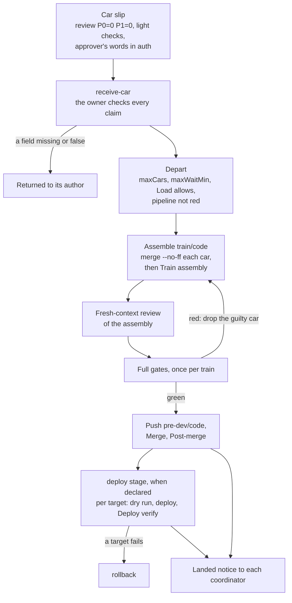

Several authors' reviewed branches (cars) enter a shared integration branch as one train: one assembly, one review of the result, one run of the heavy gates, one merge.
Each author's gates stay light, because a full suite run per car repeats the same minutes on code the train runs again.
The `integrating` and `deploying` skills carry this procedure for any project; the project's own skill supplies the concrete checks.

## A train, start to finish

<!-- Diagram: skills/integrating/SKILL.md (Stages, After the train) and its playbooks receive-car.md and train.md, skills/deploying/playbooks/deploy.md and rollback.md. -->

The steps behind each box

- **Slip.** A car enters only with a complete slip: its tickets, branch, head SHA, review verdict, light checks, migrations, lane, deploy targets, `departs` line, acceptance evidence, and the approver's words in `auth`. One missing field returns the car.
- **Depart.** The train leaves at `maxCars` (default 4), after the oldest car has waited `maxWaitMin` (default 60), or when every awaited coordinator has arrived, provided each car's `departs` line, the project's `Load`, and the branch's pipeline allow it.
- **Assemble.** On a local `train/<code>` from the latest base, merge each car with `--no-ff` in arrival order. A plain conflict is resolved and logged; a semantic conflict goes back to the later car.
- **Review and gates.** A fresh-context reviewer reads the assembly against the base for interactions between cars, conflict resolutions, and migration order. `Full gates` then run once per train. A red gate drops the guilty car and rebuilds from the rest.
- **Merge.** `pre-dev/<code>` is pushed only after green gates. Every head change voids the old head's steps, and gates rerun only for what covers the diff since each was last green.
- **Urgent car.** A car may jump the queue only on the approver's explicit "first", a fix of a P0 defect in a live deploy target, or a fix-forward car for a red integration branch. It still gets review and gates.

## Deploying

A deploy ships every car in the train at once, and a target someone depends on takes the change at once.
Order, approval, and verification are per target, because one target's success says nothing about the next.

A target is done when it runs the shipped version, read from the target as the project skill's `Deploy verify` shows it.
A green job, an accepted request, or a finished monitor is not done.

Deploy rules and rollback

- Before an `rsync --delete`, list the runtime files the target holds and confirm each is excluded.
- Run the project's tests before any deploy; inside a train, `Full gates` on the merged head is that run.
- On production and other live targets, run the dry run (Ansible `--check` or the tool's equivalent) first and read what it plans.
- Before a destructive sync, verify the target directory exists and is non-empty.
- One train at a time per target: a later train waits for the earlier one's `Deploy verify` there.
- A target is `auto` or `strict` by the settings (unlisted: `strict`). An `auto` target takes every train; a `strict` one takes only cars whose `auth` names it, checked at receipt, so a train never asks.
- A failed target goes to `rollback`: read its state, roll back as `Deploy` says, verify that it runs the previous version, return the car as a red one, and record each target's version in the ledger.
- A revert after landing goes as its own train through review, gates, merge, and deploy.

## What a host or project binds

`integrating` and `deploying` leave seven places open, called seams, where a host or a project decides who, where, or how.
An unbound seam takes its default: the session is its own batch owner and record keeper, and it asks the user before any merge to a shared branch or any deploy to a target not marked `auto`.

| Seam | Decides |
| --- | --- |
| Handoff route | How a car slip reaches the batch owner and how answers come back. |
| Batch owner | Who assembles, gates, merges, and deploys, and where its worktrees live. |
| Approval | Who authorizes a merge and each deploy target. |
| Record | Where the ledger lives. |
| Escalation route | Where `blocked`, `idle`, and deploy announcements go. |
| Settings | The integration branch, stages, targets, and thresholds. |
| Step runner | How steps are recorded and how a step that runs a command is started and reported. |

A host binds them with one `## Seam bindings` block in its session instructions, one line per seam; the project's instructions may hold one too, and the session's line wins per seam.
A binding whose mechanism the session cannot reach is a blocker, reported through the escalation route.

The project skill's headings

The project's own skill holds every concrete check, found by these headings exactly as written.
`Light checks`, `Full gates`, and `Merge` are required, and so is each heading of a declared stage.
When one is missing, the owner does not depart and escalates `blocked`, because a guessed section runs checks nobody chose.

| Heading | Holds |
| --- | --- |
| `Light checks` | The checks to run before handoff and how to report them. |
| `Train assembly` | Project steps after the cars are merged and before the gates, such as migration reordering. |
| `Full gates` | The heavy checks, how to find the guilty car on red, and which failures may be rerun as flakes. |
| `Merge` | How the train enters the integration branch. |
| `Post-merge` | What to watch after the merge, and who closes tickets. |
| `Deploy` | Stage `deploy`: how the train reaches each target, in what order, and how a failed one is rolled back. |
| `Deploy verify` | Stage `deploy`: what shows a target runs the train's own version. |
| `Acceptance` | Which kinds of `accept` apply to which cars, and where each is run. The owner does not run it. |
| `Urgent lane` | Optional: when a car may jump the queue. |
| `Load` | Optional: the project's lock name and load thresholds. |

Settings keys are `base`, `stages` (`merge` first, then optionally `deploy`), `accept`, `targets` (each `auto` or `strict`), `maxCars`, `maxWaitMin`, and `skill`.

## After the train

When a car has no stage left, its coordinator is told: "landed in `<version>`, your commit is `<sha>`".
The coordinator records the notice with `anchorloop_stage landed` and closes its ticket.
When the queue is empty and no stage runs, the owner escalates `idle` and the host closes it.
