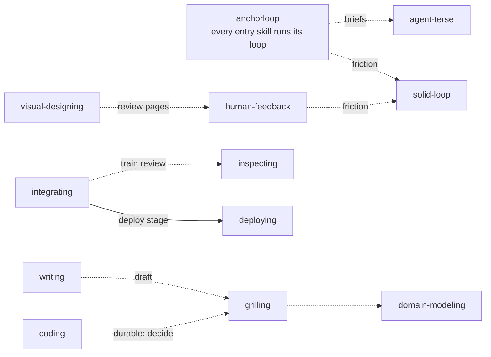

Every main task type enters through its own skill, picks a playbook, and runs the shared loop.
`anchorloop` holds what is true for every task; each entry skill names the anchor for its task type and indexes its playbooks.

## The skill tree

```text
anchorloop            core loop · principles · playbooks: autonomous-run, pause, pickup
├─ answering        explain · compare
├─ investigating    research · diagnose
├─ inspecting       diff-review · qa-release
├─ coding           bug-fix · feature · refactoring · perf · prototype · state-model  (+ Mini SDD)
├─ integrating      receive-car · train · urgent-car  (+ seams)
├─ deploying        deploy · rollback
├─ writing          draft · tighten · comments · pr-description
├─ visual-designing compare · refine · motion  (+ canvases, measure script)
└─ solid-loop       apply-friction · author-skill · bootstrap
shared              grilling · domain-modeling · human-feedback (uat) · agent-terse
```

The tree shows which entry skills exist and the playbooks each owns. Entry skills also call each other and the shared skills at fixed points:

<!-- Diagram: the cross-references found in coding/MINI-SDD.md, writing/playbooks/draft.md, grilling/SKILL.md, visual-designing/SKILL.md, human-feedback/SKILL.md, anchorloop/SKILL.md, and integrating/playbooks/train.md. -->



## Entry skills

An entry skill's anchor is the check its task type is held to.
A playbook has an ownership line, numbered steps, and a `Reply:` line that sets what the final report contains.

| Skill | Anchor | Playbooks |
| --- | --- | --- |
| `coding` | The tests that assert the touched files, widened to a shared code path's callers and the repository's tree-wide checks. | `bug-fix`, `feature`, `refactoring`, `perf`, `prototype`, `state-model` |
| `investigating` | The exact question and its completion boundary: answered, or the missing evidence named precisely. | `research`, `diagnose` |
| `inspecting` | Every scoped item has a verdict and its evidence. | `diff-review`, `qa-release` |
| `answering` | Every material claim carries its source and evidence grade. | `explain`, `compare` |
| `writing` | A reader without the conversation's context: a fresh subagent can say what the text asks of its reader. | `draft`, `tighten`, `comments`, `pr-description` |
| `visual-designing` | The person's verdict on rendered frames. | `compare`, `refine`, `motion` |
| `integrating` | The full gates passed once on the exact merged head, the review of that head holds P0=0 and P1=0, every car's approval is quoted. | `receive-car`, `train`, `urgent-car` |
| `deploying` | Each target runs the version that was shipped, read from the target, with its approval quoted. | `deploy`, `rollback` |
| `solid-loop` | The validator is clean and every edited section passes the no-op test. | `apply-friction`, `author-skill`, `bootstrap` |

<details>
<summary>`coding`: classify first, and Mini SDD for durable work</summary>

Before the first production edit, `coding` classifies the change by what it reaches: Inline, Reviewed, or Durable.
Reviewed work follows `references/reviewed.md` for its premises and independent review.
Durable work follows `MINI-SDD.md`: a `docs/specs/<date>-<slug>/` folder with `decision.md`, `spec.md`, `design.md`, and `verification.md`, where the spec waits for the user's approval before any production edit.
The `state-model` playbook checks a flow with several actors, retries, restarts, or timeouts as a TLA+ model whose bug paths become red tests.

</details>

<details>
<summary>`visual-designing`: frames as SVG, measured and reviewed</summary>

The skill has agents draw UI comps, native app or web screens, and purely visual pieces as hand-written SVG frames.
A script that drives `agent-browser` (Node) measures them for overflowing text, overlaps, small tap targets, and state-layer shifts.
The frames are rendered to PNG for the agent's own check, then handed to a person on a `show_doc` review page to choose a direction or accept each frame.
A flow is a sequence of frames, and a transition or loading state is a looping animated SVG.

</details>

## Shared skills

Entry skills call these when a task needs them:

- `grilling` resolves decisions the user owns, in rounds of numbered questions with a recommended answer each.
- `domain-modeling` reconciles the user's language, the project's glossary, and the code, and records terms and ADRs.
- `human-feedback` turns a person's reaction to working output into an evidence-backed root cause, and runs UAT: a person checks the screenshots of an e2e flow.
- `agent-terse` governs text only agents read: briefs, reports, and agent messages.

## Lifecycle playbooks and principles

`anchorloop` carries three lifecycle playbooks that wrap an entry playbook:

- `autonomous-run`: the user steps away and the run drives to a predicate without them.
- `pause`: an explicit pause, going offline, a restart, or imminent compaction.
- `pickup`: resuming or taking over a prior run's work.

`PRINCIPLES.md` indexes the named principles playbooks cite, such as Subtract before you add, Prove it works, and Minimize tests.
The user can steer a run with the same names.
