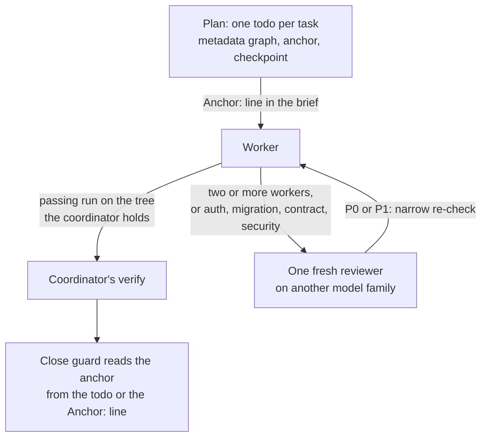
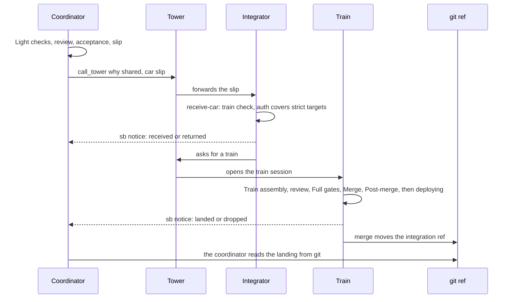

[pi-straw-boss](https://wayne930242.github.io/pi-straw-boss/docs/) decides who works and where: a main agent per tab, a tower per workspace, a head tower for you, and an integrator and train sessions for merges.
anchorloop decides what counts as done inside each of those sessions: the anchor, its passing run after the last change, and the review rule.
anchorloop works without pi-straw-boss, and pi-straw-boss's merge train needs the `integrating` and `deploying` skills; together, a ticket goes from a plan to a landed change with evidence at every step.

This page covers only the seams between them; each project's own pages explain the rest.

## Who does what

<!-- Sources: ~/projects/pi-straw-boss docs/how-it-works.md (positions, main kinds), prompts/main.md, prompts/integrator.md, prompts/train.md; anchorloop skills/anchorloop and skills/integrating. -->

| Session | pi-straw-boss gives it | anchorloop gives it |
| --- | --- | --- |
| Main agent (`coordinator`) | The tab's chain of command: plans, dispatches workers, asks the boss. | The loop: each todo's `metadata.anchor` is its check, a worker's passing run is the coordinator's verify, and two or more workers bring a reviewer on another model family. |
| Tower | Routes work between the mains of a workspace; forwards car slips. | Nothing it needs: it forwards, and the loops run in the sessions it routes to. |
| Integrator (`integ <project>`) | Receives and places cars, and asks the tower to open trains. | The `integrating` skill's `receive-car` playbook. |
| Train (`train <code>`) | A session of its own for one train. | The `integrating` and `deploying` skills' steps. |

How the two fit

A main's kind (`coordinator`, `integrator`, `standing`) is a pi-straw-boss notion; anchorloop has no kinds, only the one loop rule every session runs.

The two packages meet at three points: the todo list a plan writes, the merge-train contract that makes `integrating` and `deploying` the train's procedure, and the resume note a handoff carries.

## A coordinator's plan

A plan is todos, and each todo's `metadata.anchor` names its check.
The brief hands that check to the worker as its `Anchor:` line, so the plan, the worker's check, and the coordinator's verify are one check.

<!-- Diagram: ~/projects/pi-straw-boss prompts/planning.md (graph, anchor, checkpoint metadata, blockedBy); anchorloop skills/anchorloop/SKILL.md (Review, Delegation), pi/close-guard.ts. -->

What each side writes

pi-straw-boss's planning prompt has the coordinator write one todo per task with `subject`, `owner`, `description`, `blockedBy`, and `metadata` of `graph` (`single-loop`, `fan-out/fan-in`, or `orchestrator-worker`), `anchor`, and `checkpoint`.
pi-straw-boss refuses a worker dispatch until a todo names a graph.

anchorloop reads `metadata.anchor` as the task's own check, and the close guard counts it like an `Anchor:` line.
The coordinator reviews each worker's diff, not its report, and runs the check again only when its own change or an integration altered the tree the worker passed on.

## A merge train, end to end

pi-straw-boss moves the car and tells its coordinator what became of it; anchorloop supplies the procedure that decides it.
The coordinator counts the change as landed only when git shows it in the integration ref.

<!-- Diagram: ~/projects/pi-straw-boss site guide/merge-train.md and prompts/main.md, integrator.md, train.md; anchorloop skills/integrating (receive-car, train), skills/deploying. -->

The steps on each side

- The coordinator builds the slip as `receive-car` step 1 describes (a review with no P0 or P1, behaviour tests for its change, the project skill's `Light checks`, the acceptance the app requires) and sends it with `call_tower` `why: shared`, then waits for sb's car notice.
- The tower forwards the slip to the project's one integrator, opening it when none runs.
- The integrator checks every claim at receipt (`train check`, and `auth` covering every `strict` target) and sets each car's fate with `train_car`; the sb server sends the notice.
- The train runs `integrating`'s `Train assembly`, review, `Full gates`, `Merge`, and `Post-merge`, then `deploying` where the stages say so. It never waits on a person.
- A car's notice is one of received, returned, dropped, or landed. The coordinator confirms a landed one in git (`git merge-base --is-ancestor`, or equal patch ids) before closing its ticket.

## What pi-straw-boss binds

`integrating` and `deploying` leave seven seams open, and pi-straw-boss binds all seven in its prompts.
Where a project binds none, anchorloop's default applies: the session is its own owner and asks the user.

| Seam | pi-straw-boss binding |
| --- | --- |
| Handoff route | The sender sends the car slip with `call_tower` `why: shared`; the tower forwards it to the project's integrator; the sb server sends every car notice to the slip's `coordinator`; the train sets each state with `train_car`. |
| Batch owner | The project's one integrator schedules trains; each departed train runs in a `train` session the tower opens, in `~/.herdr/worktrees/<repo>/train-<code>`. |
| Approval | The boss. The sender quotes the boss's words in `auth`, and the integrator groups cars by the `strict` targets their `auth` covers. |
| Record | `trains/<project>/<app>.json` (the integrator's index) and one file per train, under sb's state directory. |
| Escalation route | `call_tower`: `blocked`, `idle` as `milestone`, and a deploy the integrator starts itself as `shared` naming the target. |
| Settings | The `integration` field of `apps.json`: `base`, `skill`, `stages`, `targets`, `accept`, `maxCars`, `maxWaitMin`, `maxTrains`. |
| Step runner | Every step is a todo with `metadata.sb`; a step that runs a command runs as a `MonitorCreate` that sb wraps. |

The merge-train contract

pi-straw-boss checks that the two skills pi loaded each declare `merge-train-contract: "1"` in their frontmatter, and until they do, a train's and the integrator's `todo` and `MonitorCreate` calls that change something are refused.
pi-anchorloop implements version 1 since 2.11.0, and pi-straw-boss accepts pi-anchorloop 2.11.0 or newer without the declaration.
[The contract](https://wayne930242.github.io/pi-straw-boss/docs/guide/merge-train/#the-merge-train-contract) lists exactly what version 1 assumes.

## Rotating a long-lived session

A main that runs for days hands over through a resume note, so the next session starts from the anchor and what the run already proved.

The handoff

The `pause` playbook commits a `wip:` and writes `scratch/resume-<task-slug>.md`: intent, the anchor, each unit's status, the next action, and gotchas.
The new session follows the `pickup` playbook: it restates the anchor, redoes nothing the note shows finished, and verifies inherited claims on the real artifact before reporting done.

