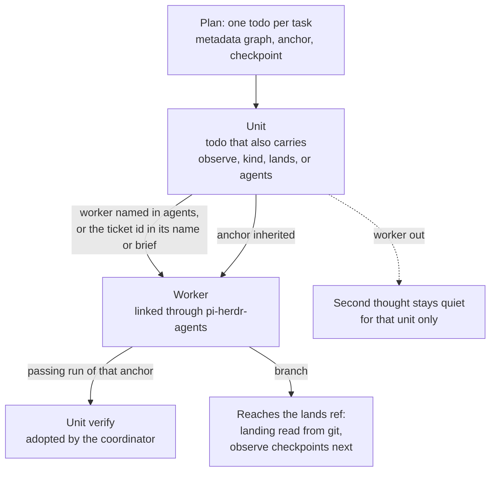
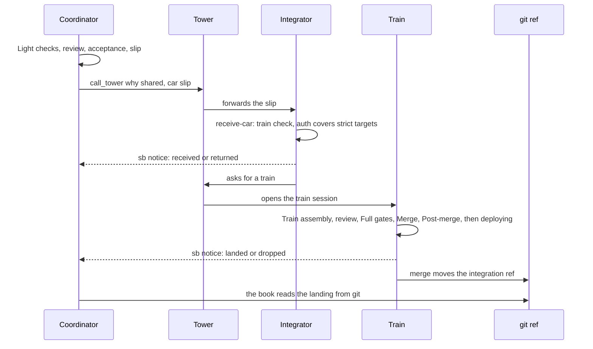

[pi-straw-boss](https://wayne930242.github.io/pi-straw-boss/docs/) decides who works and where: a main agent per tab, a tower per workspace, a head tower for you, and an integrator and train sessions for merges.
anchorloop decides what counts as done inside each of those sessions: the loop's kind, its anchor, its verify, the review gate, the book, and the notice.
anchorloop works without pi-straw-boss, and pi-straw-boss's merge train needs the `integrating` and `deploying` skills; together, a ticket goes from a plan to a landed change with evidence at every step.

This page covers only the seams between them; each project's own pages explain the rest.

## Who does what

<!-- Sources: ~/projects/pi-straw-boss docs/how-it-works.md (positions, main kinds), prompts/main.md, prompts/integrator.md, prompts/train.md; anchorloop skills/integrating and pi/book.ts. -->

| Session | pi-straw-boss gives it | anchorloop gives it |
| --- | --- | --- |
| Main agent (`coordinator`) | The tab's chain of command: plans, dispatches workers, asks the boss. | A loop book: the plan's todos become units, workers are linked, and their evidence rolls up. |
| Tower | Routes work between the mains of a workspace; forwards car slips. | Nothing it needs: it forwards, and the loops run in the sessions it routes to. |
| Integrator (`integ <project>`) | Receives and places cars, and asks the tower to open trains. | The `integrating` skill's `receive-car` playbook. |
| Train (`train <code>`) | A session of its own for one train. | The `integrating` and `deploying` skills' steps, and the loop book its first todo opens. |

How the two fit

A main's kind (`coordinator`, `integrator`, `standing`) is a pi-straw-boss notion; a loop's kind (`quick`, `inline`, `reviewed`, `durable`) is an anchorloop notion.
They are independent: a `coordinator` main can run an `inline` loop for one ticket and a `durable` loop for the next.

The two packages meet at three contracts: the todo list a plan writes, the merge-train contract that makes `integrating` and `deploying` the train's procedure, and the book id a handoff carries.

## A coordinator's plan

A plan is todos, and the book reads the same todos as units.
The anchor a plan names for a task becomes the anchor its worker inherits, so the plan, the worker's check, and the coordinator's verify are one check.

<!-- Diagram: ~/projects/pi-straw-boss prompts/planning.md (graph, anchor, checkpoint metadata, blockedBy); anchorloop pi/support/units.ts (unitsOf, childAnchor, outDispatches), pi/book.ts (adopted verify), pi/second-thought.ts (per-unit quiet). -->

What each side writes

pi-straw-boss's planning prompt has the coordinator write one todo per task with `subject`, `owner`, `description`, `blockedBy`, and `metadata` of `graph` (`single-loop`, `fan-out/fan-in`, or `orchestrator-worker`), `anchor`, and `checkpoint`.
pi-straw-boss refuses a worker dispatch until a todo names a graph.

anchorloop reads `metadata.anchor` as the task's own check; the first todo's anchor becomes the loop's anchor.
A todo becomes a unit when it also carries `observe`, `kind`, `lands`, or `agents`; the planning prompt does not write those, so a coordinator that wants per-ticket phases adds them.
Without them, a worker whose name or brief holds the ticket id of exactly one open todo is bound to that todo and makes it a unit.

A unit's phases, its workers' trees, its quiet notice, and its landing follow [Subagents and units](/anchorloop/reference/how-it-works/subagents-and-units/) and [Landing](/anchorloop/reference/how-it-works/landing/).

## A merge train, end to end

pi-straw-boss moves the car and tells its coordinator what became of it; anchorloop supplies the procedure that decides it.
The coordinator's loop counts the change as landed only when git shows it in the integration ref.

<!-- Diagram: ~/projects/pi-straw-boss site guide/merge-train.md and prompts/main.md, integrator.md, train.md; anchorloop skills/integrating (receive-car, train), skills/deploying, pi/support/landing.ts. -->

The steps on each side

- The coordinator builds the slip as `receive-car` step 1 describes (a review with no P0 or P1, behaviour tests for its change, the project skill's `Light checks`, the acceptance the app requires) and sends it with `call_tower` `why: shared`, then waits for sb's car notice.
- The tower forwards the slip to the project's one integrator, opening it when none runs.
- The integrator checks every claim at receipt (`train check`, and `auth` covering every `strict` target) and sets each car's fate with `train_car`; the sb server sends the notice.
- The train runs `integrating`'s `Train assembly`, review, `Full gates`, `Merge`, and `Post-merge`, then `deploying` where the stages say so. It never waits on a person.
- A car's notice is one of received, returned, dropped, or landed. The coordinator may record the landed one with `anchorloop_stage landed`, and git checks it the same way it reads any landing: by ancestry, equal patch ids, or equal content.

## What pi-straw-boss binds

`integrating` and `deploying` leave seven seams open, and pi-straw-boss binds all seven in its prompts.
Where a project binds none, anchorloop's default applies: the session is its own owner and asks the user.

| Seam | pi-straw-boss binding |
| --- | --- |
| Handoff route | The sender sends the car slip with `call_tower` `why: shared`; the tower forwards it to the project's integrator; the sb server sends every car notice to the slip's `coordinator`; the train sets each state with `train_car`. |
| Batch owner | The project's one integrator schedules trains; each departed train runs in a `train` session the tower opens, in `~/.herdr/worktrees/<repo>/train-<code>`. |
| Approval | The boss. The sender quotes the boss's words in `auth`, and the integrator groups cars by the `strict` targets their `auth` covers. |
| Record | `trains/<project>/<app>.json` (the integrator's index) and one file per train, under sb's state directory. |
| Escalation route | `call_tower`: `blocked`, `idle` as `milestone`, and a deploy the integrator starts itself as `shared` naming the target. |
| Settings | The `integration` field of `apps.json`: `base`, `skill`, `stages`, `targets`, `accept`, `maxCars`, `maxWaitMin`, `maxTrains`. |
| Step runner | Every step is a todo with `metadata.sb`; a step that runs a command runs as a `MonitorCreate` that sb wraps. |

The merge-train contract

pi-straw-boss checks that the two skills pi loaded each declare `merge-train-contract: "1"` in their frontmatter, and until they do, a train's and the integrator's `todo` and `MonitorCreate` calls that change something are refused.
pi-anchorloop implements version 1 since 2.11.0, and pi-straw-boss accepts pi-anchorloop 2.11.0 or newer without the declaration.
[The contract](https://wayne930242.github.io/pi-straw-boss/docs/guide/merge-train/#the-merge-train-contract) lists exactly what version 1 assumes.

## Rotating a long-lived session

A main that runs for days hands over its loop by id, so the next session starts with what each unit already proved.

The handoff

The `pause` playbook writes a resume note that holds the open loop book's id, the `book:` line of `anchorloop_stage read`.
The new session passes that id as `resume` on its first `anchorloop_stage kind`, before any todo, as the `pickup` playbook says.
The book moves to the new session, and the old one is told on its next call.

[Handoff](/anchorloop/reference/how-it-works/handoff/) draws the exchange and lists the refusals.

