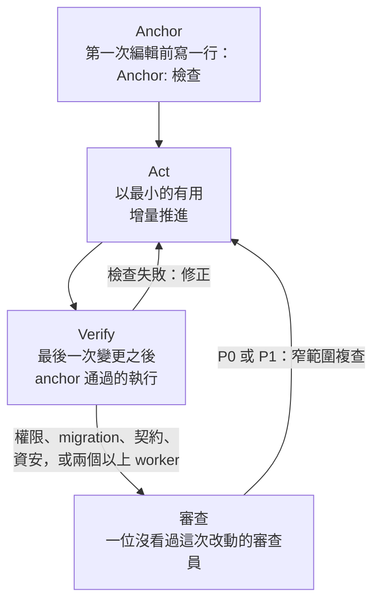

anchorloop 有兩半。
skill 告訴 agent 怎麼工作：每種任務一個入口 skill，各有 playbook，全部跑同一個循環。
兩個小型 extension 只抓程式碼裡便宜就抓得到的事：沒有通過 anchor 就收尾，以及 skill 檔案寫歪。

## 循環

每個任務都只跑一條規則：先講好檢查，再改，最後拿出通過的結果。

<!-- 圖：skills/anchorloop/SKILL.md 的「The rule」與 pi/close-guard.ts。 -->

每一步要求什麼

- **Anchor。** 第一次編輯前，agent 寫下 `Anchor: <check>`，每條指令用反引號包住；也可以是觀察結果的審查或某個人的判定。todo 的 `metadata.anchor` 也算。
- **Act。** 依專案原本的做法以小增量推進，先刪再加。把工作單元委派出去；持有請求的 session 保有 anchor 和回覆。
- **Verify。** 最後一次變更之後，拿出 anchor 通過的執行，並回報它觀察到什麼。anchor 沒有驗到的需求就是 `unknown`，不論其他檢查怎麼說。

## Anchor

anchor 是觀察結果的那一個確切檢查，要在第一次變更前選定。
只看過綠燈的檢查什麼也證明不了，所以這次執行新寫的檢查，要先因為所說的原因跑出紅燈。
沒有理由就不重跑：執行前，agent 先收集這棵樹已有的通過紀錄，只跑涵蓋上次通過之後 diff 的部分。

改關卡不是修正

調高預算、加入允許清單或忽略條目、跳過或 xfail 測試、停用檢查或讓它失敗也算過，都是改關卡。
回覆要逐項寫明理由讓使用者接受，也要放到 reviewer 面前，因為想看到綠燈的正是作者本人。

## 審查

涉及授權或權限資料、migration、共用契約或資安的改動，以及兩個以上 worker 共同完成的改動，都交給一位沒看過該改動的審查員。
P0 和 P1 會擋住合併，並只窄範圍複查那些發現和修正改到的行；P2 以下列為後續事項。

## 收尾守門

一次執行停下時，若檔案改過之後反引號 anchor 沒有通過的執行，收尾守門就在 session 加上一行，例如 ``anchorloop: no passing run of `pytest -q` after the last change.``
這一行不會開啟新的一輪；agent 用那次執行回應，或說明這個 anchor 為什麼不適用。
[收尾守門](/anchorloop/zh-tw/reference/how-it-works/the-close-guard/)列出確切什麼算數。

## Friction 變成規則

某條指令誤導了一次嘗試時，agent 記下它怎麼說、嘗試發現了什麼，任務結束後由 `solid-loop` 從根本修正那條指令。

兩個類別

- **Misdirection**：指令所說或暗示的，被嘗試推翻。`apply-friction` playbook 修正或刪除那一行。
- **Gap**：沒有任何使用中的指令寫出發現的事實。playbook 把它放到該放的地方，優先用機制（架構、腳本、lint 或測試）而不是文字。

