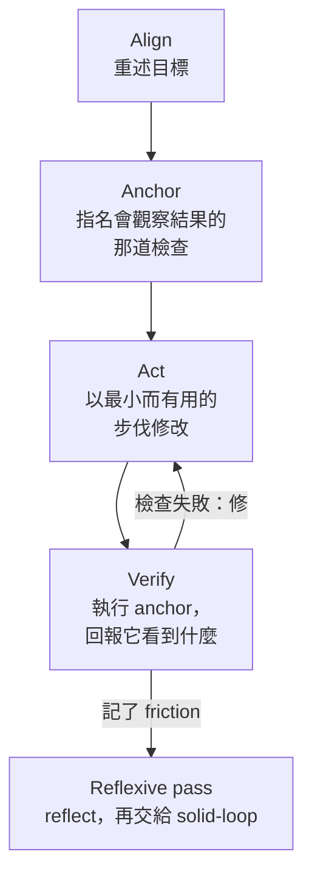
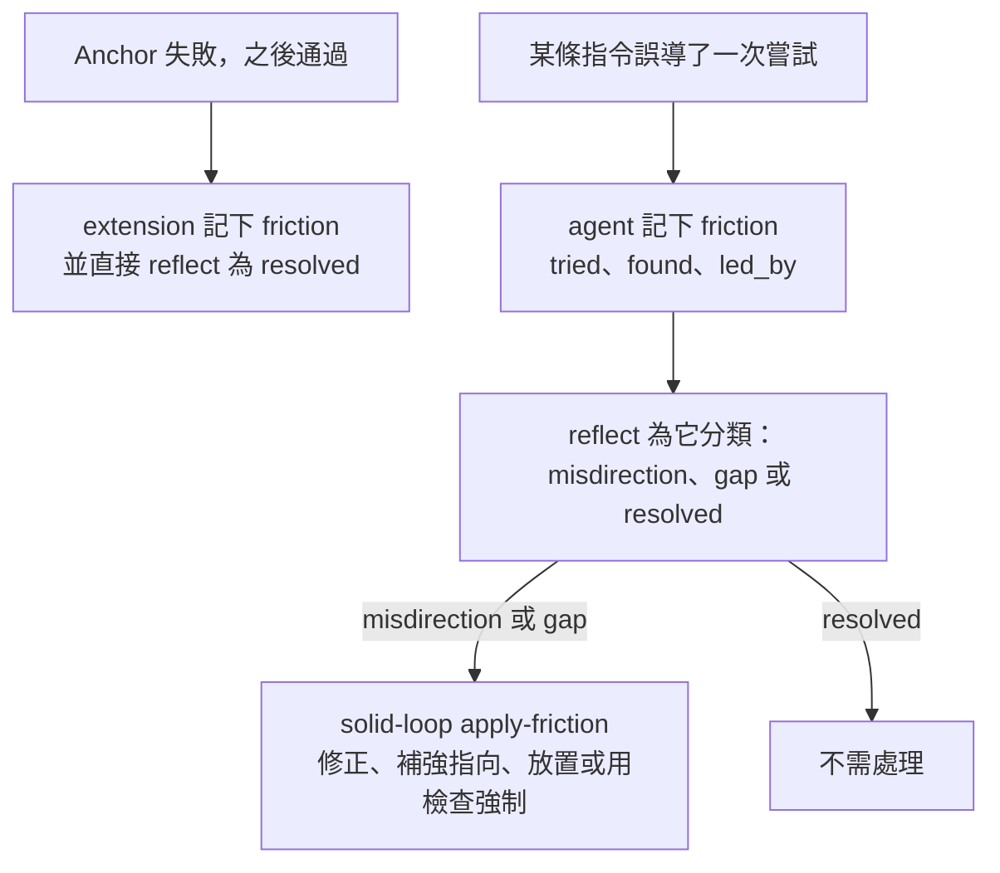

anchorloop 有兩半。
skill 告訴 agent 怎麼工作：每種任務一個入口 skill，各有 playbook，全部跑同一個循環。
extension 盯著工作進行，說出還缺什麼。

## 循環

每個任務都跑 Align → Anchor → Act → Verify；這次執行記了 friction 的話，後面接一輪 Reflexive pass。

<!-- 圖：skills/anchorloop/SKILL.md 的四個循環小節與 Reflexive Pass。 -->

每一步要求什麼

- **Align。** 除了完全明確的一行修改，任何任務的第一則回覆都以使用者的語言寫 `Alignment: <目標、問題、最小改動>` 開頭，並直接往下做，不等確認。
- **Anchor。** 第一筆修改前，loop 要有 anchor：一行 `Reality anchor: <會觀察結果的那道指令，以及它的檢查點>`、第一個 todo 的 `metadata.anchor`，或 `kind` 呼叫的 `anchor`。
- **Act。** 以專案原生的做法小步前進，先刪後加。把工作單元委派出去；握有需求的 session 保有 loop。
- **Verify。** 執行 anchor 並回報它觀察到的結果。anchor 沒有涵蓋的需求一律是 `unknown`，不論其他檢查怎麼說。

## 種類

loop 有四種，種類決定它的階段順序。
第一個 `todo` 以 `inline` 開啟 loop；用 `kind` 呼叫選別的種類。

| 種類 | 用於 | 階段 |
| --- | --- | --- |
| `quick` | 一個設定值、一個錯字、一處小調整。 | act → check → reflect → close |
| `inline` | 預設：改動留在它編輯的檔案裡。 | anchor → act → verify → reflect → close |
| `reviewed` | 改動超出它的檔案：共用契約、權限、migration 或安全。 | anchor → act → verify → review → reflect → close |
| `durable` | 工作需要留下設計紀錄：有模糊之處、使用者要做取捨，或使用者要求寫 spec。 | decide → grill → spec → read → approve → design → anchor → act → verify → review → reflect → close |

何時改種類

`quick` 或 `inline` loop 跑 anchor 時會量 diff。
達到 3 個原始碼檔案、2 個頂層目錄，或有 1 個 README、changelog、schema 檔跟原始碼一起改時，結果會請 agent 重新分類，`verify` 要等到以 `reason` 回應的 `kind` 呼叫才算完成。
`durable` loop 的紀錄放在 `docs/specs/<日期>-<slug>/`：`decision.md`、`spec.md`、`design.md` 與 `verification.md`，各在走到那個階段時才建立。

[階段](/anchorloop/zh-tw/reference/how-it-works/phases/)畫出每一種順序，[影響範圍](/anchorloop/zh-tw/reference/how-it-works/reach/)列出門檻。

## Anchor 與檢查點

anchor 是會觀察結果的那道檢查，在第一筆修改前就選定。
只見過通過的檢查什麼也證明不了，所以為這次執行新寫的檢查，要先在說得出理由的失敗下跑過一次。

anchor 有一個執行檢查點，也就是併入前跑的指令；另有 `observe` 檢查點，檢查只有併入後的結果才看得到的事：健康檢查、資料列數、使用者驗收。
每個 observe 檢查點都要在最後一次併入之後，以 `verify` 加 `checkpoint` 編號結案。

改 gate 不是修復

調高預算、加 allowlist 或 ignore 項目、跳過或 xfail 測試，以及停用或軟化檢查，都是 gate 的改動。
回覆要逐項寫出理由，讓使用者決定是否接受；change-set 有 review anchor 時也要一併交給那位 reviewer，因為作者就是想要綠燈的人。

## Unit 與子代理

把票派給 worker 的協調者只有一個 loop，每張票是一個有自己階段的 unit。
帶有 `observe`、`kind`、`lands` 或 `agents` metadata 的 todo 是一個 unit；子代理以名稱或票號綁定它，繼承它的 anchor，通過的那次 anchor 執行就算該 unit 的 verify。

[子代理與 unit](/anchorloop/zh-tw/reference/how-it-works/subagents-and-units/)有圖和規則。

## 併入

整合 ref 握有 worker 的改動，就算併入了：祖先、patch id 相同或內容相同，從 git 讀出，從不解析指令的文字。
擁有者也可以用 `anchorloop_stage landed` 記錄通知，git 以同樣方式檢查它。

## Friction 變成規則

被指令誤導過的執行會把它記下來，loop 為它分類，再由 `solid-loop` 從根源修正那條指令。

<!-- 圖：pi/book.ts 的 autoFriction、skills/anchorloop/SKILL.md 的 Reflexive Pass、skills/solid-loop/playbooks/apply-friction.md。 -->

三個類別

- **Misdirection**：`led_by` 那一行所說或暗示的，被 `found` 推翻。playbook 修正或刪除那一行。
- **Gap**：沒有任何使用中的指令寫出 `found` 這個事實。playbook 把它放到該放的地方，優先用機制（架構、腳本、lint 或測試）而不是文字。
- **Resolved**：這次改動本身已解決，或是沒有任何指令負責的工具失誤。

通過後又失敗再通過的重跑，會自動記下並直接 resolved，所以 friction 記錄留給事後才查出原因的失敗。

