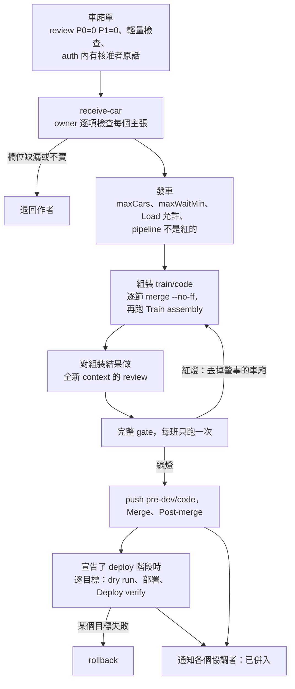

幾位作者審過的 branch（車廂）併成一班列車進入共用的整合 branch：一次組裝、一次審查合成的結果、一次完整 gate、一次合併。
每位作者自己的 gate 保持輕量，因為每節車廂都跑一次完整測試，是在列車會再跑一次的程式碼上重複同樣的時間。
`integrating` 與 `deploying` 兩個 skill 放通用流程，適用任何專案；具體的檢查由專案自己的 skill 提供。

## 一班列車，從頭到尾

<!-- 圖：skills/integrating/SKILL.md（Stages、After the train）與它的 playbook receive-car.md、train.md，以及 skills/deploying/playbooks/deploy.md、rollback.md。 -->

每個方塊背後的步驟

- **車廂單。** 車廂要附完整的單才能進來：票號、branch、head SHA、review 結論、輕量檢查、migration、車道、部署目標、`departs` 那一行、驗收證據，以及 `auth` 裡核准者的原話。缺一個欄位就退回。
- **發車。** 列車在達到 `maxCars`（預設 4）、最舊的車廂等滿 `maxWaitMin`（預設 60），或等待中的協調者都到齊時出發，前提是每節車廂的 `departs` 那一行、專案的 `Load` 與該 branch 的 pipeline 都允許。
- **組裝。** 在本機 `train/<code>` 上從最新的 base 出發，依到達順序逐節 `--no-ff` merge。單純的衝突自己解決並記錄；語意衝突退回給較晚的那一節。
- **Review 與 gate。** 全新 context 的 reviewer 對照 base 閱讀組裝結果，找車廂之間的交互作用、衝突解法與 migration 順序。接著每班只跑一次 `Full gates`。紅燈就丟掉肇事的車廂，用其餘的重新組裝。
- **合併。** gate 全綠之後才 push `pre-dev/<code>`。head 每次改變，舊 head 的步驟全部作廢，gate 只重跑涵蓋自上次綠燈以來 diff 的部分。
- **急件車廂。** 只有核准者明說「先上」、修正上線中部署目標的 P0 缺陷，或修復紅燈整合 branch 的 fix-forward 車廂，才可以插隊。它仍然要 review 和 gate。

## 部署

一次部署把列車上每節車廂一起送出去，而有人依賴的目標會立刻吃到改動。
順序、核准與驗證都逐目標進行，因為一個目標成功，說明不了下一個。

目標跑的是已發出的版本才算完成，要用專案 skill 的 `Deploy verify` 從目標讀出來。
job 綠燈、請求被接受，或 monitor 結束，都不算完成。

部署規則與 rollback

- `rsync --delete` 之前，先列出目標上的 runtime 檔案，確認每一個都已排除。
- 任何部署之前先跑專案的測試；在列車裡，合併後 head 上的 `Full gates` 就是那次測試。
- 在 production 與其他上線中的目標，先跑 dry run（Ansible 的 `--check` 或該工具的對應功能）並讀它預計做什麼。
- 破壞性的同步之前，先確認目標目錄存在且不是空的。
- 每個目標同一時間只有一班列車：後一班要等前一班在那裡通過 `Deploy verify`。
- 目標依設定是 `auto` 或 `strict`（沒列出的是 `strict`）。`auto` 的目標接每一班列車；`strict` 的只接 `auth` 指名它的車廂，在收件時檢查，所以列車從不發問。
- 失敗的目標交給 `rollback`：讀它的狀態、依 `Deploy` 的寫法 rollback、驗證它跑的是前一個版本、把車廂當作紅燈退回，並把每個目標的版本記進帳本。
- 併入後的 revert 要自成一班列車，走過 review、gate、merge 與 deploy。

## host 或專案要綁定什麼

`integrating` 與 `deploying` 留了七個空位，稱為 seam，由 host 或專案決定由誰、在哪裡、怎麼做。
沒綁定的 seam 用預設：session 自己當 batch owner 與記錄者，合併到共用 branch 或部署到未標 `auto` 的目標前，先問使用者。

| Seam | 決定什麼 |
| --- | --- |
| Handoff route | 車廂單怎麼送到 batch owner，答覆怎麼回來。 |
| Batch owner | 誰組裝、跑 gate、合併與部署，以及它的 worktree 放在哪裡。 |
| Approval | 誰核准合併，以及每個部署目標。 |
| Record | 帳本放在哪裡。 |
| Escalation route | `blocked`、`idle` 與部署公告送到哪裡。 |
| Settings | 整合 branch、階段、目標與門檻。 |
| Step runner | 步驟怎麼記錄，以及執行指令的步驟怎麼啟動與回報。 |

host 在 session 指令裡用一段 `## Seam bindings` 綁定它們，每個 seam 一行；專案的指令也可以放一段，同一個 seam 以 session 的那一行為準。
綁定的機制 session 碰不到時，那是一個 blocker，要透過 escalation route 回報。

專案 skill 的標題

專案自己的 skill 放每一項具體檢查，靠下面這些原樣寫出的標題找到。
`Light checks`、`Full gates` 與 `Merge` 是必備的，宣告的每個階段所需的標題也是。
缺一個時，owner 不發車並升級為 `blocked`，因為猜出來的段落會跑沒人選過的檢查。

| 標題 | 內容 |
| --- | --- |
| `Light checks` | 交接前要跑的檢查，以及怎麼回報。 |
| `Train assembly` | 車廂合併之後、gate 之前的專案步驟，例如 migration 重新排序。 |
| `Full gates` | 重量級檢查、紅燈時怎麼找出肇事的車廂，以及哪些失敗可以當成 flake 重跑。 |
| `Merge` | 列車怎麼進入整合 branch。 |
| `Post-merge` | 合併後要盯什麼，以及誰來關票。 |
| `Deploy` | `deploy` 階段：列車怎麼到達每個目標、順序，以及失敗的目標怎麼 rollback。 |
| `Deploy verify` | `deploy` 階段：什麼能證明目標跑的是這班列車的版本。 |
| `Acceptance` | 哪些種類的 `accept` 適用於哪些車廂，以及各在哪裡執行。owner 不執行它。 |
| `Urgent lane` | 選用：車廂什麼時候可以插隊。 |
| `Load` | 選用：專案的鎖名稱與負載門檻。 |

設定的 key 有 `base`、`stages`（`merge` 在前，之後可加 `deploy`）、`accept`、`targets`（各為 `auto` 或 `strict`）、`maxCars`、`maxWaitMin` 與 `skill`。

## 列車之後

車廂沒有剩下的階段時，會通知它的協調者：「landed in `<version>`, your commit is `<sha>`」。
協調者用 `anchorloop_stage landed` 記錄這則通知並關票。
佇列清空、也沒有階段在跑時，owner 升級為 `idle`，由 host 關閉它。
