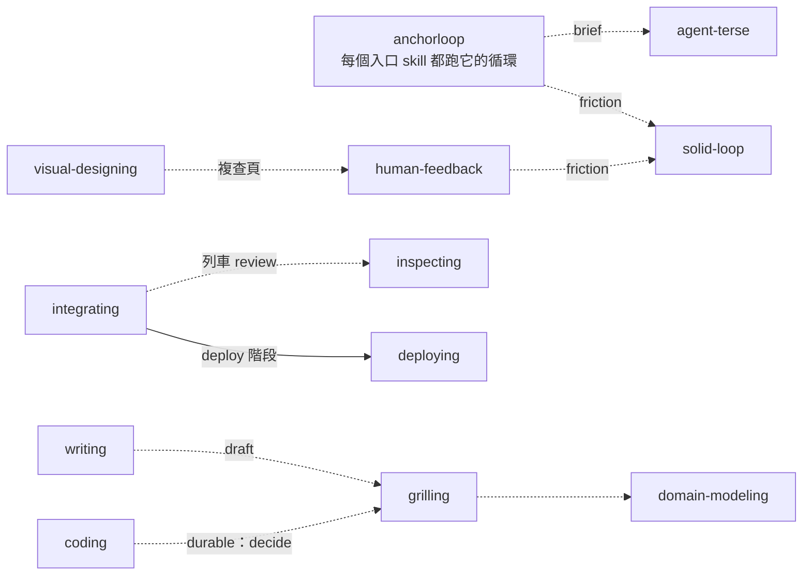

每一種主要任務都從自己的 skill 進來，選一本 playbook，然後跑同一個循環。
`anchorloop` 放每一種任務都成立的做法；每個入口 skill 寫出這類任務的 anchor，並列出自己的 playbook。

## Skill 樹

```text
anchorloop            核心循環 · 原則 · playbook：autonomous-run、pause、pickup
├─ answering        explain · compare
├─ investigating    research · diagnose
├─ inspecting       diff-review · qa-release
├─ coding           bug-fix · feature · refactoring · perf · prototype · state-model（+ Mini SDD）
├─ integrating      receive-car · train · urgent-car（+ seams）
├─ deploying        deploy · rollback
├─ writing          draft · tighten · comments · pr-description
├─ visual-designing compare · refine · motion（+ canvases、量測腳本）
└─ solid-loop       apply-friction · author-skill · bootstrap
共用                grilling · domain-modeling · human-feedback (uat) · agent-terse
```

這棵樹列出有哪些入口 skill，以及各自擁有的 playbook。入口 skill 也會在固定的地方互相呼叫，或呼叫共用 skill：

<!-- 圖：coding/MINI-SDD.md、writing/playbooks/draft.md、grilling/SKILL.md、visual-designing/SKILL.md、human-feedback/SKILL.md、anchorloop/SKILL.md 與 integrating/playbooks/train.md 裡找得到的相互引用。 -->



## 入口 skill

入口 skill 的 anchor 是這類任務要通過的檢查。
每本 playbook 有一行擁有權說明、編號步驟，以及一行 `Reply:` 規定最後的回報要包含什麼。

| Skill | Anchor | Playbook |
| --- | --- | --- |
| `coding` | 斷言被改動檔案的測試；共用程式路徑則擴大到它的呼叫者，以及整個 repo 的檢查。 | `bug-fix`、`feature`、`refactoring`、`perf`、`prototype`、`state-model` |
| `investigating` | 精確的問題與它的完成界線：已回答，或精確指出缺少的證據。 | `research`、`diagnose` |
| `inspecting` | 範圍內每一項都有結論與證據。 | `diff-review`、`qa-release` |
| `answering` | 每個重要主張都附出處與證據等級。 | `explain`、`compare` |
| `writing` | 一位沒有對話脈絡的讀者：全新的 subagent 能說出這段文字要讀者做什麼。 | `draft`、`tighten`、`comments`、`pr-description` |
| `visual-designing` | 人對已渲染畫面的結論。 | `compare`、`refine`、`motion` |
| `integrating` | 完整 gate 在實際合併的那個 head 上通過一次、該 head 的 review 為 P0=0 且 P1=0、每節車廂的核准都有引述。 | `receive-car`、`train`、`urgent-car` |
| `deploying` | 每個目標都在跑已發出的版本，從目標讀出，並附核准的引述。 | `deploy`、`rollback` |
| `solid-loop` | 驗證器乾淨，且每個編輯過的段落都通過 no-op 測試。 | `apply-friction`、`author-skill`、`bootstrap` |

<details>
<summary>`coding`：先分類，durable 工作用 Mini SDD</summary>

第一筆 production 修改前，`coding` 依改動影響的範圍分類：Inline、Reviewed 或 Durable。
Reviewed 的工作依 `references/reviewed.md` 處理前提與獨立 review。
Durable 的工作依 `MINI-SDD.md`：一個 `docs/specs/<日期>-<slug>/` 資料夾，放 `decision.md`、`spec.md`、`design.md` 與 `verification.md`，spec 要等使用者核准才能做任何 production 修改。
`state-model` playbook 把有多個參與者、重試、重啟或逾時的流程，當成 TLA+ 模型檢查，找到的 bug 路徑變成會失敗的測試。

</details>

<details>
<summary>`visual-designing`：把畫面畫成 SVG，量測、再複查</summary>

這個 skill 讓 agent 用手寫 SVG 畫 UI 比稿、原生 app 或網頁畫面，以及純視覺作品。
驅動 `agent-browser` 的腳本（Node）量測文字溢出、重疊、過小的觸控目標與狀態圖層位移。
畫面先轉成 PNG 讓 agent 自己檢查，再用 `show_doc` 的複查頁交給人挑方向或逐張確認。
流程拆成多張畫面，轉場和載入狀態畫成循環播放的動畫 SVG。

</details>

## 共用 skill

入口 skill 在任務需要時呼叫它們：

- `grilling` 處理使用者要做的決定：分輪提出編號問題，每題附建議答案。
- `domain-modeling` 對齊使用者的用語、專案的詞彙表與程式碼，並記錄術語和 ADR。
- `human-feedback` 把人對成品的反應變成有證據的根因，也跑 UAT：由人複查 e2e 流程的擷圖。
- `agent-terse` 處理只給 agent 讀的文字：任務 brief、回報、agent 之間的訊息。

## 生命週期 playbook 與原則

`anchorloop` 有三本包在入口 playbook 外面的生命週期 playbook：

- `autonomous-run`：使用者離開，執行自己朝一個判準推進。
- `pause`：明確的暫停、離線、重啟，或即將壓縮 context。
- `pickup`：接手或繼續前一輪的工作。

`PRINCIPLES.md` 列出 playbook 引用的具名原則，例如 Subtract before you add、Prove it works 與 Minimize tests。
使用者也可以用同樣的名稱中途修正方向。
