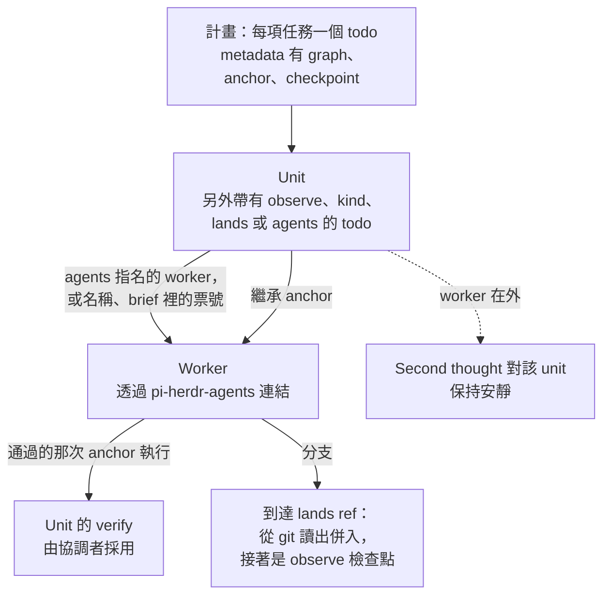
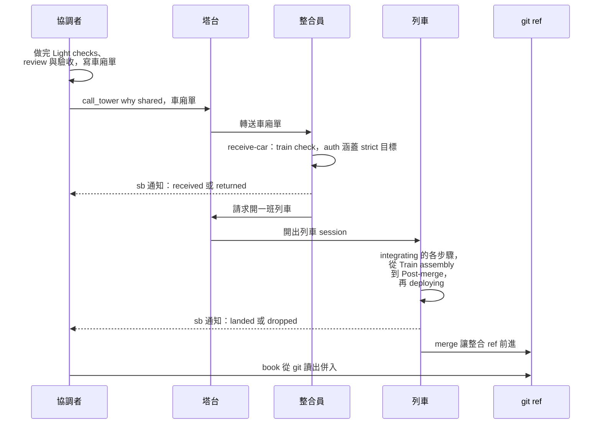

[pi-straw-boss](https://wayne930242.github.io/pi-straw-boss/docs/zh-tw/) 決定誰在哪裡工作：每個分頁一個主 agent、每個工作區一座塔台、給你用的主塔台，以及負責合併的整合員與列車 session。
anchorloop 決定每個 session 裡什麼才算完成：loop 的種類、anchor、verify、review 關卡、book 與提醒。
anchorloop 不靠 pi-straw-boss 也能用，而 pi-straw-boss 的合併列車需要 `integrating` 與 `deploying` 兩個 skill；合起來用，一張票從計畫走到併入，每一步都有證據。

這一頁只講兩者之間的接縫；各專案自己的頁面會說明其餘部分。

## 誰做什麼

<!-- 來源：~/projects/pi-straw-boss 的 docs/how-it-works.md（各種位置、main 的種類）、prompts/main.md、prompts/integrator.md、prompts/train.md；anchorloop 的 skills/integrating 與 pi/book.ts。 -->

| Session | pi-straw-boss 給它 | anchorloop 給它 |
| --- | --- | --- |
| 主 agent（`coordinator`） | 該分頁的指揮鏈：做計畫、派 worker、問 boss。 | 一本 loop book：計畫的 todo 變成 unit，worker 被連結起來，它們的證據往上匯總。 |
| 塔台 | 在工作區的各個 main 之間轉送工作；轉送車廂單。 | 不需要什麼：它只轉送，loop 在它轉送去的 session 裡跑。 |
| 整合員（`integ <project>`） | 收下並安排車廂，請塔台開列車。 | `integrating` skill 的 `receive-car` playbook。 |
| 列車（`train <code>`） | 為一班列車開的獨立 session。 | `integrating` 與 `deploying` skill 的步驟，以及它第一個 todo 開出來的 loop book。 |

兩者怎麼配合

main 的種類（`coordinator`、`integrator`、`standing`）是 pi-straw-boss 的概念；loop 的種類（`quick`、`inline`、`reviewed`、`durable`）是 anchorloop 的概念。
兩者互相獨立：`coordinator` 的 main 可以為一張票跑 `inline` loop，下一張票跑 `durable` loop。

兩個套件在三個契約上相接：計畫寫下的 todo 清單、讓 `integrating` 與 `deploying` 成為列車流程的 merge-train 契約，以及交接帶著的 book id。

## 協調者的計畫

計畫就是 todo，而 book 把同一批 todo 讀成 unit。
計畫替某項任務指名的 anchor，就是它的 worker 繼承的 anchor，所以計畫、worker 的檢查與協調者的 verify 是同一道檢查。

<!-- 圖：~/projects/pi-straw-boss 的 prompts/planning.md（graph、anchor、checkpoint metadata，blockedBy）；anchorloop 的 pi/support/units.ts（unitsOf、childAnchor、outDispatches）、pi/book.ts（adopted verify）、pi/second-thought.ts（逐 unit 安靜）。 -->

雙方各寫什麼

pi-straw-boss 的 planning prompt 要協調者每項任務寫一個 todo，帶 `subject`、`owner`、`description`、`blockedBy`，以及 `metadata` 的 `graph`（`single-loop`、`fan-out/fan-in` 或 `orchestrator-worker`）、`anchor` 與 `checkpoint`。
todo 沒有指名 graph 前，pi-straw-boss 會拒絕派 worker。

anchorloop 把 `metadata.anchor` 讀成該任務自己的檢查；第一個 todo 的 anchor 成為 loop 的 anchor。
todo 另外帶有 `observe`、`kind`、`lands` 或 `agents` 時才成為 unit；planning prompt 不寫這些，所以想要逐票階段的協調者要自己加上。
沒有它們時，名稱或 brief 裡的票號恰好對應一個未完成 todo 的 worker，會綁定那個 todo 並讓它成為 unit。

unit 的階段、worker 的 tree、安靜的提醒與併入，依[子代理與 unit](/anchorloop/zh-tw/reference/how-it-works/subagents-and-units/)和[併入](/anchorloop/zh-tw/reference/how-it-works/landing/)。

## 一班合併列車，從頭到尾

pi-straw-boss 搬運車廂，並告訴協調者它的下場；anchorloop 提供決定下場的流程。
協調者的 loop 要等 git 顯示改動已在整合 ref 裡，才算它已併入。

<!-- 圖：~/projects/pi-straw-boss 的 site guide/merge-train.md 與 prompts/main.md、integrator.md、train.md；anchorloop 的 skills/integrating（receive-car、train）、skills/deploying、pi/support/landing.ts。 -->

雙方的步驟

- 協調者依 `receive-car` 第 1 步建立車廂單（沒有 P0 或 P1 的 review、針對該改動的行為測試、專案 skill 的 `Light checks`、app 要求的驗收），用 `call_tower` `why: shared` 送出，然後等 sb 的車廂通知。
- 塔台把車廂單轉送給專案唯一的整合員，沒有整合員在跑時就開一個。
- 整合員在收件時檢查每個主張（`train check`，以及 `auth` 涵蓋每個 `strict` 目標），並用 `train_car` 設定每節車廂的下場；通知由 sb server 送出。
- 列車跑 `integrating` 的 `Train assembly`、review、`Full gates`、`Merge` 與 `Post-merge`，stages 有寫的話再跑 `deploying`。它從不等人。
- 車廂的通知是 received、returned、dropped 或 landed 之一。協調者可以用 `anchorloop_stage landed` 記錄 landed 那則，git 以讀取任何併入的方式檢查它：祖先、patch id 相同或內容相同。

## pi-straw-boss 綁定什麼

`integrating` 與 `deploying` 留了七個 seam，pi-straw-boss 在它的 prompt 裡把七個都綁定了。
專案什麼都沒綁時，用 anchorloop 的預設：session 自己當 owner，並詢問使用者。

| Seam | pi-straw-boss 的綁定 |
| --- | --- |
| Handoff route | 寄件者用 `call_tower` `why: shared` 送出車廂單；塔台轉送給專案的整合員；sb server 把每則車廂通知送給車廂單的 `coordinator`；列車用 `train_car` 設定每個狀態。 |
| Batch owner | 專案唯一的整合員安排列車；每班出發的列車在塔台開的 `train` session 裡執行，放在 `~/.herdr/worktrees/<repo>/train-<code>`。 |
| Approval | boss。寄件者把 boss 的話引述在 `auth`，整合員依 `auth` 涵蓋的 `strict` 目標替車廂分組。 |
| Record | sb 狀態目錄下的 `trains/<project>/<app>.json`（整合員的索引），以及每班列車一個檔案。 |
| Escalation route | `call_tower`：`blocked`、當作 `milestone` 的 `idle`，以及整合員自己啟動的部署，用 `shared` 並指名目標。 |
| Settings | `apps.json` 的 `integration` 欄位：`base`、`skill`、`stages`、`targets`、`accept`、`maxCars`、`maxWaitMin`、`maxTrains`。 |
| Step runner | 每個步驟是帶 `metadata.sb` 的 todo；執行指令的步驟以 sb 包起來的 `MonitorCreate` 執行。 |

merge-train 契約

pi-straw-boss 檢查 pi 載入的兩個 skill 是否各在 frontmatter 宣告 `merge-train-contract: "1"`；沒宣告之前，列車與整合員會改動東西的 `todo` 與 `MonitorCreate` 呼叫都會被拒絕。
pi-anchorloop 從 2.11.0 起實作版本 1，而 pi-straw-boss 接受 2.11.0 或更新、沒有宣告的 pi-anchorloop。
[契約](https://wayne930242.github.io/pi-straw-boss/docs/zh-tw/guide/merge-train/#合併火車契約)列出版本 1 的完整假設。

## 輪替長壽的 session

連續跑好幾天的 main 以 id 交出它的 loop，讓下一個 session 一開始就握有這個 loop 已證明的事；各 unit 的審查與落地要重新取得。

交接

`pause` playbook 寫的接續筆記裡有未關 loop book 的 id，也就是 `anchorloop_stage read` 的 `book:` 那一行。
新 session 依 `pickup` playbook，在第一次 `anchorloop_stage kind` 帶這個 id 當 `resume`，且要在任何 todo 之前。
book 搬到新 session，舊 session 在下一次呼叫時被告知。

[交接](/anchorloop/zh-tw/reference/how-it-works/handoff/)畫出整個交換，並列出拒絕的情形。

