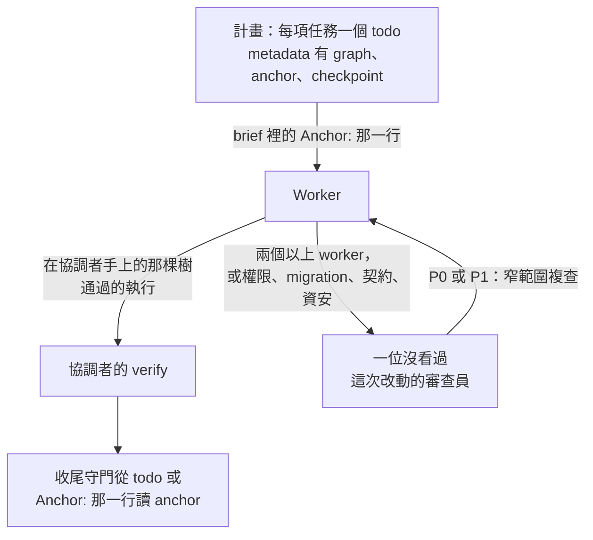
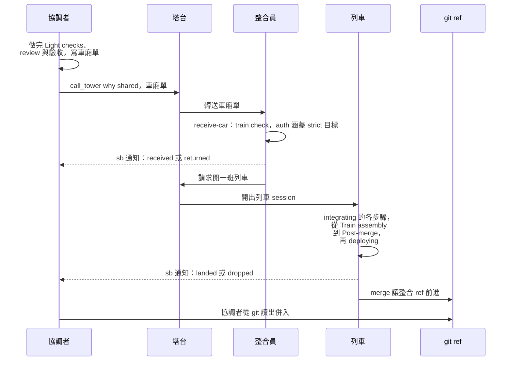

[pi-straw-boss](https://wayne930242.github.io/pi-straw-boss/docs/zh-tw/) 決定誰在哪裡工作：每個分頁一個主 agent、每個工作區一座塔台、給你用的主塔台，以及負責合併的整合員與列車 session。
anchorloop 決定每個 session 裡什麼才算完成：anchor、最後一次變更之後它通過的執行，以及審查規則。
anchorloop 不靠 pi-straw-boss 也能用，而 pi-straw-boss 的合併列車需要 `integrating` 與 `deploying` 兩個 skill；合起來用，一張票從計畫走到併入，每一步都有證據。

這一頁只講兩者之間的接縫；各專案自己的頁面會說明其餘部分。

## 誰做什麼

<!-- 來源：~/projects/pi-straw-boss 的 docs/how-it-works.md（各種位置、main 的種類）、prompts/main.md、prompts/integrator.md、prompts/train.md；anchorloop 的 skills/anchorloop 與 skills/integrating。 -->

| Session | pi-straw-boss 給它 | anchorloop 給它 |
| --- | --- | --- |
| 主 agent（`coordinator`） | 該分頁的指揮鏈：做計畫、派 worker、問 boss。 | 循環：每個 todo 的 `metadata.anchor` 是它的檢查，worker 通過的執行就是協調者的 verify，兩個以上 worker 共同完成的改動，交給一位沒看過該改動的審查員。 |
| 塔台 | 在工作區的各個 main 之間轉送工作；轉送車廂單。 | 不需要什麼：它只轉送，loop 在它轉送去的 session 裡跑。 |
| 整合員（`integ <project>`） | 收下並安排車廂，請塔台開列車。 | `integrating` skill 的 `receive-car` playbook。 |
| 列車（`train <code>`） | 為一班列車開的獨立 session。 | `integrating` 與 `deploying` skill 的步驟。 |

兩者怎麼配合

main 的種類（`coordinator`、`integrator`、`standing`）是 pi-straw-boss 的概念；anchorloop 沒有種類，每個 session 都跑同一條循環規則。

兩個套件在三個地方相接：計畫寫下的 todo 清單、讓 `integrating` 與 `deploying` 成為列車流程的 merge-train 契約，以及交接帶著的接續筆記。

## 協調者的計畫

計畫就是 todo，每個 todo 的 `metadata.anchor` 指名它的檢查。
brief 把這道檢查當成 `Anchor:` 那一行交給 worker，所以計畫、worker 的檢查與協調者的 verify 是同一道檢查。

<!-- 圖：~/projects/pi-straw-boss 的 prompts/planning.md（graph、anchor、checkpoint metadata，blockedBy）；anchorloop 的 skills/anchorloop/SKILL.md（Review、Delegation）、pi/close-guard.ts。 -->

雙方各寫什麼

pi-straw-boss 的 planning prompt 要協調者每項任務寫一個 todo，帶 `subject`、`owner`、`description`、`blockedBy`，以及 `metadata` 的 `graph`（`single-loop`、`fan-out/fan-in` 或 `orchestrator-worker`）、`anchor` 與 `checkpoint`。
todo 沒有指名 graph 前，pi-straw-boss 會拒絕派 worker。

anchorloop 把 `metadata.anchor` 讀成該任務自己的檢查，收尾守門把它當成 `Anchor:` 那一行計算。
協調者審的是每個 worker 的 diff，不是它的回報；只有自己的改動或整合改變了 worker 通過的那棵樹時，才再跑一次檢查。

## 一班合併列車，從頭到尾

pi-straw-boss 搬運車廂，並告訴協調者它的下場；anchorloop 提供決定下場的流程。
協調者要等 git 顯示改動已在整合 ref 裡，才算它已併入。

<!-- 圖：~/projects/pi-straw-boss 的 site guide/merge-train.md 與 prompts/main.md、integrator.md、train.md；anchorloop 的 skills/integrating（receive-car、train）、skills/deploying。 -->

雙方的步驟

- 協調者依 `receive-car` 第 1 步建立車廂單（沒有 P0 或 P1 的 review、針對該改動的行為測試、專案 skill 的 `Light checks`、app 要求的驗收），用 `call_tower` `why: shared` 送出，然後等 sb 的車廂通知。
- 塔台把車廂單轉送給專案唯一的整合員，沒有整合員在跑時就開一個。
- 整合員在收件時檢查每個主張（`train check`，以及 `auth` 涵蓋每個 `strict` 目標），並用 `train_car` 設定每節車廂的下場；通知由 sb server 送出。
- 列車跑 `integrating` 的 `Train assembly`、review、`Full gates`、`Merge` 與 `Post-merge`，stages 有寫的話再跑 `deploying`。它從不等人。
- 車廂的通知是 received、returned、dropped 或 landed 之一。協調者先在 git 確認 landed 那則（`git merge-base --is-ancestor`，或 patch id 相同），再關票。

## pi-straw-boss 綁定什麼

`integrating` 與 `deploying` 留了七個 seam，pi-straw-boss 在它的 prompt 裡把七個都綁定了。
專案什麼都沒綁時，用 anchorloop 的預設：session 自己當 owner，並詢問使用者。

| Seam | pi-straw-boss 的綁定 |
| --- | --- |
| Handoff route | 寄件者用 `call_tower` `why: shared` 送出車廂單；塔台轉送給專案的整合員；sb server 把每則車廂通知送給車廂單的 `coordinator`；列車用 `train_car` 設定每個狀態。 |
| Batch owner | 專案唯一的整合員安排列車；每班出發的列車在塔台開的 `train` session 裡執行，放在 `~/.herdr/worktrees/<repo>/train-<code>`。 |
| Approval | boss。寄件者把 boss 的話引述在 `auth`，整合員依 `auth` 涵蓋的 `strict` 目標替車廂分組。 |
| Record | sb 狀態目錄下的 `trains/<project>/<app>.json`（整合員的索引），以及每班列車一個檔案。 |
| Escalation route | `call_tower`：`blocked`、當作 `milestone` 的 `idle`，以及整合員自己啟動的部署，用 `shared` 並指名目標。 |
| Settings | `apps.json` 的 `integration` 欄位：`base`、`skill`、`stages`、`targets`、`accept`、`maxCars`、`maxWaitMin`、`maxTrains`。 |
| Step runner | 每個步驟是帶 `metadata.sb` 的 todo；執行指令的步驟以 sb 包起來的 `MonitorCreate` 執行。 |

merge-train 契約

pi-straw-boss 檢查 pi 載入的兩個 skill 是否各在 frontmatter 宣告 `merge-train-contract: "1"`；沒宣告之前，列車與整合員會改動東西的 `todo` 與 `MonitorCreate` 呼叫都會被拒絕。
pi-anchorloop 從 2.11.0 起實作版本 1，而 pi-straw-boss 接受 2.11.0 或更新、沒有宣告的 pi-anchorloop。
[契約](https://wayne930242.github.io/pi-straw-boss/docs/zh-tw/guide/merge-train/#合併火車契約)列出版本 1 的完整假設。

## 輪替長壽的 session

連續跑好幾天的 main 透過接續筆記交接，讓下一個 session 從 anchor 和這輪已證明的事開始。

交接

`pause` playbook 提交一個 `wip:`，並寫 `scratch/resume-<task-slug>.md`：意圖、anchor、各 unit 的狀態、下一步與注意事項。
新 session 依 `pickup` playbook：重述 anchor，筆記顯示已完成的事不重做，回報完成前在真正的產出物上驗證繼承來的主張。

